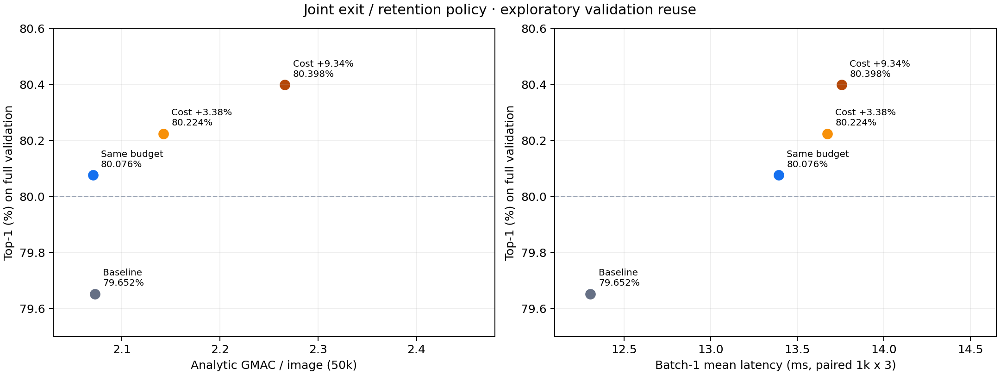

# ThinkingViT: 기존 평균 계산 예산으로 정확도 80% 달성

이 브랜치(`codex/target80-results`)는 **3H 종료 기준과 6H 토큰 유지율을 함께 조정한 실험**을 공유합니다. 기존 파인튜닝 학생 가중치와 공식 전처리를 유지하고, ImageNet-1K validation 50,000장을 실제 조건부 GPU 추론으로 평가했습니다.

## 핵심 결과

| 정책 | Top-1 | 평균 GMAC/장 | Batch-1 평균 지연시간 |
|---|---:|---:|---:|
| 기존 학생 · 고정 50% | 79.652% | 2.0723 | 12.31ms |
| **기존 예산 내 공동 정책** | **80.076%** | **2.0704** | **13.39ms** |
| 추가 비용 +3.38% | 80.224% | 2.1423 | 13.67ms |
| 추가 비용 +9.34% | 80.398% | 2.2659 | 13.76ms |

정확도는 **0.424%p 상승**, 정답 수는 **212장 증가**, 평균 분석 MAC은 **0.09% 감소**했습니다. 대신 지연시간은 **8.8% 증가**했습니다. 정확도와 평균 MAC 예산 목표를 충족한 결과이며, 실제 속도 개선은 확인하지 못했습니다.

시간은 RTX 3090에서 같은 이미지 1,000장·batch 1·warmup 50·3회로 측정했습니다. 3H, 게이트, Top-K, recycling, 선택된 6H 실행을 포함하고 이미지 전처리와 입력 H2D는 제외했습니다.

**평가 범위:** 기존 validation의 보정용 25,000장으로 정책을 선택했습니다. 전체 수치는 보정용을 포함하고, 나머지 25,000장도 과거 실험에서 확인한 자료입니다. 독립된 새 평가나 모집단 정확도 80% 보장을 뜻하지 않습니다. MAC은 분석식이며 게이트·정규화 등의 모든 실행 비용을 포함하지 않습니다.

## 선택 규칙

| 3H entropy | 실행 |
|---|---|
| 0.8 미만 | 3H에서 종료 |
| 0.8 이상, 1.25 미만 | 6H에서 패치 49개 유지 · 25% |
| 1.25 이상 | 6H에서 패치 98개 유지 · 50% |

CLS는 항상 포함합니다. entropy는 공식 구현의 **상위 10개 클래스 확률을 재정규화한 entropy**입니다. 비선택 토큰을 제거하는 **token drop**이며, 최초 제안의 토큰 보존형 selective refinement와 구분합니다.

기존에 종료하던 entropy 0.8~1.0 구간에 가벼운 6H를 추가해 정답이 275장 순증했고, 1.0~1.25 구간의 토큰을 줄이면서 63장을 잃었습니다. 종료 기준을 1.0으로 고정했던 이전 선택기 실험과 비교 범위가 다릅니다.



## 공유 자료

| 확인할 내용 | 파일 |
|---|---|
| 전체 결과·분할별 수치·신뢰구간·속도·한계 | [실험 보고서](baseline/reports/2026-11-08/target80/report.md) |
| 설치·CPU 재계산·GPU 재실행 | [실행 안내](baseline/target80_README.md) |
| 고정한 탐색·학습 계획 | [실험 설정](configs/target80_20261108.json) |
| 실제 GPU 정확도 표 | [comparison.csv](baseline/reports/2026-11-08/target80/gpu_accuracy/comparison.csv) |
| 실제 사용한 정책 | [locked_policies.json](baseline/reports/2026-11-08/target80/gpu_accuracy/locked_policies.json) |
| 지연시간과 반복별 요약 | [latency_summary.json](baseline/reports/2026-11-08/target80/latency_summary.json) |
| 사후 crossfit 결과 | [crossfit_pooled.csv](baseline/reports/2026-11-08/target80/diagnostics/crossfit_pooled.csv) |
| GPU 없이 재계산할 수 있는 수치 자료 | [numeric_artifacts.zip](baseline/reports/2026-11-08/target80/replay/numeric_artifacts.zip) |

## 빠른 재계산

```bash
git clone --branch codex/target80-results https://github.com/hee4040/OnDevice.git
cd OnDevice
python3.10 -m venv .venv
.venv/bin/python -m pip install -r requirements.txt

# 이미지와 모델 가중치 없이 저장된 수치 자료를 복원합니다.
.venv/bin/python scripts/restore_target80_artifacts.py

# 보정용만으로 정책을 다시 선택하고 원래 결과와 비교할 수 있습니다.
.venv/bin/python baseline/target80_gate_search.py \
  --source results/20261107T091527.251697Z-adaptive-drop \
  --output results/target80-replay/gate_search
```

압축 자료에는 entropy, 정답 여부, 예측 클래스, 이미지 ID·파일명, 분할, 정책, 시간 원자료가 들어 있습니다. 이미지와 모델 가중치는 포함하지 않습니다. 복원기는 파일별 SHA-256을 확인하고 기존 실험 폴더가 있으면 덮어쓰지 않습니다. 저장된 수치를 다시 계산하는 것과 모델을 다시 실행하는 것은 구분합니다.

GPU 재실행에는 ImageNet validation, 공식 ThinkingViT 코드·가중치, 동일한 학생 가중치가 필요합니다. 학생 SHA-256은 `a14958ad4da105c9e0290aacadd6c7d83ce6003831090351cfc0fd13eb6562bd`입니다. 실행 방법은 [안내](baseline/target80_README.md)에 있습니다.

## 재현 범위와 코드 구성

- 측정 당시 기준 커밋 [5d53816](https://github.com/hee4040/OnDevice/tree/5d53816941d30a3e89b43ef9dc69b52d3ff03c4f)에서 분기했습니다.
- `target80_gate_search.py`: 종료 기준·유지율 공동 탐색.
- `target80_runtime.py`, `evaluate_target80.py`: 실제 조건부 추론과 전체 정확도 평가.
- `measure_target80.py`: 같은 표본의 지연시간 비교.
- `diagnose_target80.py`, `report_target80.py`: 사후 안정성 분석, 수치 검증과 보고서 생성.
- `adaptive_drop.py`, `analyze_adaptive_drop.py`, `evaluate_nonmonotone_entropy.py`: 실행 당시 사용한 공통 계산·bootstrap 의존 모듈. 이 브랜치의 실행 진입점은 target80 스크립트입니다.
- `finetune_target80.py`: 추가 학습 준비 코드. 두 변형의 10단계 점검만 수행했으며, 보고된 80% 결과는 원래 학생 가중치를 사용했습니다.

보고서의 53개 테스트는 원래 전체 실험 작업트리에서 수행한 검사 수입니다. 이 공유 브랜치는 이번 결과와 필요한 의존 모듈·테스트만 포함합니다. 공유 브랜치의 43개 검사도 통과했으며, `.venv/bin/python -m unittest discover -s tests -v`로 다시 실행할 수 있습니다. 수치 자료 복원 후 정책과 비교표 12행이 원본과 정확히 일치하는 것도 확인했습니다.

선행 H1·토큰 제거 실험은 [상세 보고서](baseline/h1_diagnosis.md), 기존 early-exit 베이스라인은 [사용법](baseline/README.md)에서 볼 수 있습니다. 각 문서의 장비·가중치·측정 조건을 구분해 비교해야 합니다.
