# ThinkingViT 실패 분석

**분석일: 2026-10-15 · ImageNet-1K validation 50,000장 · 3H → 6H · Entropy threshold 1.0**

## 1. 분석 목적과 주요 결과

선택적 토큰 갱신을 적용하기 전에, 기존 ThinkingViT의 추가 계산이 어떤 예측을 개선하고 어떤 예측을 악화시키는지 확인한다. 특히 **지정 정답과 다른 예측**과 **사람이 보아도 명백한 인식 실패**를 구분한다.

- 실제 게이트가 6H를 선택한 18,004장 중 4,330장은 오답→정답, 945장은 정답→오답이었다. 추가 계산의 순정답 증가는 3,385장이다.
- 악화된 945장 중 913장(96.6%)은 지정 정답이 6H Top-5 안에 남았다. 786장(83.2%)은 오답으로 바뀌면서 Entropy가 낮아졌다.
- 재검토 라벨인 ImageNet ReaL에서는 이 945장 중 260장의 6H 예측도 정답으로 인정됐다. 따라서 모든 악화를 이미지 이해의 실패로 설명할 수는 없다.
- 두 라벨 기준에서 모두 악화된 466장도 사람이 쉽게 판정할 수 있는 이미지라는 뜻은 아니다. 무작위 사례를 확인했을 때 여러 대상, 유사 클래스, 크롭 등의 애매함이 남았다.

이 보고서는 **관측된 예측·확률·라벨 판정**과 **시각적 관찰·미검증 가설**을 구분한다. Attention이나 특정 토큰이 실패를 유발했다는 인과적 결론은 아직 내리지 않는다.

## 2. 실험 조건과 분석 범위

| 항목 | 설정 |
| --- | --- |
| 모델 | 공식 ThinkingViT, thinking stages `[3, 6]`, EMA 가중치 |
| 데이터 | ImageNet-1K validation 50,000장, 클래스별 50장 |
| 입력 | 224×224, crop_pct 0.9, bicubic, center crop, 공식 정규화 |
| 연산 | FP32, AMP off, TF32 allowed, RTX 3090 한 장 |
| 추론 배치 / 이미지 순서 | batch 128 / seed 42 |
| 라우팅 | 공식 Entropy threshold 1.0 |
| 시각 점검 | 945장 중 40장 무작위 비복원 추출, seed 20261015 |

오프라인 분석에서는 **모든 이미지에 3H와 6H를 실행**했다. 아래의 “6H 진입 대상”은 실제 Entropy 게이트가 선택하는 집합이며, “3H 종료 대상의 6H 결과”는 배포 경로에서 실행되지 않을 단계를 추가 계산한 사후 분석이다. 분석 실행시간을 latency로 보고하지 않는다.

정답→오답 945장의 확률은 해당 이미지만 모아 다시 계산했다. 배치 구성이 달라졌지만 **945장 모두 원래의 3H·6H Top-1 예측이 재현**됐다. 작은 확률 차이는 가능하므로 이미지별 확률은 이 재계산 결과로 일관되게 제시한다.

## 3. 전체 예측의 변화

| 3H → 전체 6H | 전체 50,000장 | 6H 진입 대상 18,004장 | 3H 종료 대상 31,996장 |
| --- | ---: | ---: | ---: |
| 정답 → 정답 | 35,522 | 6,965 | 28,557 |
| 오답 → 정답 | 5,198 | 4,330 | 868 |
| 정답 → 오답 | 1,245 | 945 | 300 |
| 오답 → 오답 | 8,035 | 5,764 | 2,271 |

| 예측 경로 | Top-1 | 정답 수 / 평가 수 |
| --- | ---: | ---: |
| 3H만 사용 | 73.534% | 36,767 / 50,000 |
| 모든 이미지에서 3H+6H 사용 | 81.440% | 40,720 / 50,000 |
| 기존 게이트 적용 | 80.304% | 40,152 / 50,000 |

게이트 적용의 순정답 증가는 `4,330 − 945 = 3,385장`, 전체 기준 **6.770%p**다. 6H 진입 대상 중 3H가 맞혔던 7,910장의 11.95%가 6H에서 틀렸다. 이 비율은 전체 이미지에서의 실패율이 아니라 **추가 계산 전에는 맞혔던 진입 대상에 조건을 건 비율**이다.

최종 오답 9,848장은 다음과 같이 구성된다.

| 최종 오답의 위치 | 이미지 수 | 9,848장 중 비율 |
| --- | ---: | ---: |
| 3H에서 조기 종료한 오답 | 3,139 | 31.9% |
| 6H 진입 후 두 단계 모두 오답 | 5,764 | 58.5% |
| 6H 진입 후 정답→오답 | 945 | 9.6% |

따라서 945장의 분석은 전체 오류 분석의 일부다. 3H에서 종료한 오답과 두 단계 모두 틀린 사례의 원인까지 설명한 것은 아니다.

## 4. 정답→오답 945장에서 관측된 확률 변화

| 관측 항목 | 이미지 수 / 945 | 비율 |
| --- | --- | --- |
| 지정 정답이 6H 2위로 남음 | 719 | 76.1% |
| 지정 정답이 6H Top-5 안에 남음 | 913 | 96.6% |
| 지정 정답이 6H Top-5 밖으로 밀려남 | 32 | 3.4% |
| 3H의 2위 후보가 6H의 1위가 됨 | 513 | 54.3% |
| 6H의 1위 후보가 이미 3H Top-5에 있었음 | 814 | 86.1% |
| 지정 정답 확률도 올랐지만 순위는 역전됨 | 136 | 14.4% |
| 오답으로 바뀌면서 Entropy가 낮아짐 | 786 | 83.2% |

각 행은 서로 배타적인 실패 유형이 아니므로 합산하지 않는다. 많은 사례에서 상위 후보 간 순서가 바뀌지만, Top-5에 정답이 남는다는 사실만으로 내부 특징이 보존됐다고 단정할 수는 없다. Softmax 확률은 사람이 판정한 정확도나 보정된 신뢰도를 뜻하지 않는다.

**더 확신하는 출력이 더 올바른 출력이라는 보장은 없다.** ReaL에서도 악화로 남은 466장 중 378장(81.1%)의 Entropy가 낮아졌다. 단, 이 조건부 분석만으로 “두 단계 중 Entropy가 낮은 출력을 고르는 규칙”의 전체 정확도를 평가한 것은 아니다.

## 5. 라벨 기준을 바꾸면 실패 판정도 달라지는가?

[ImageNet ReaL](https://github.com/google-research/reassessed-imagenet)은 ImageNet validation 라벨을 재검토한 자료다. 한 이미지에서 여러 클래스가 정답으로 인정될 수 있고, 정답 목록이 비어 있는 이미지는 평가에서 제외한다. 원래 정답이 재검토 후 인정되지 않을 수도 있다. 관련 논문은 [Are we done with ImageNet?](https://arxiv.org/abs/2006.07159)이다.

### 5.1 기존 정답→오답 945장의 재평가

| ReaL에서의 판정 | 이미지 수 | 기존 945장 중 비율 |
| --- | ---: | ---: |
| 두 예측 모두 정답 | 156 | 16.5% |
| 3H 오답 → 6H 정답 | 104 | 11.0% |
| 여전히 3H 정답 → 6H 오답 | 466 | 49.3% |
| 두 예측 모두 오답 | 74 | 7.8% |
| 정답 목록이 비어 평가 제외 | 145 | 15.3% |

기존 기준의 오답 중 **260장(156+104)은 6H 예측도 인정**됐다. 기존 945장의 27.5%, 평가 가능한 800장의 32.5%다. 이 260장이 모두 여러 물체 때문에 생긴 실패라는 뜻은 아니다. 원래 라벨의 변경과 클래스 경계 문제도 포함된다.

### 5.2 전체 악화가 절반으로 줄었다는 해석은 불가능

전체 6H 진입 대상에서 ReaL 기준의 정답→오답은 **938장**이다. 기존 집합과 겹치는 466장 외에 새로 악화로 판정된 472장이 있다.

| ReaL 악화 938장의 원래 판정 | 이미지 수 |
| --- | ---: |
| 원래도 정답→오답 | 466 |
| 원래는 오답→정답 | 261 |
| 원래는 둘 다 오답 | 211 |
| 합계 | 938 |

ReaL 평가가 가능한 6H 진입 대상은 15,560장이고, 그중 교정은 3,330장, 악화는 938장이다. 순정답 증가는 2,392장으로 여전히 양수다. 라벨 기준이 바뀌면 **교정 집합과 악화 집합 모두 달라진다.**

### 5.3 평가 분모를 맞춘 정확도 비교

| 예측 경로 | 원래 정답 · 전체 50,000장 | 원래 정답 · 동일 46,837장 | ReaL · 46,837장 |
| --- | --- | --- | --- |
| 3H | 73.534% | 75.949% | 81.226% |
| 항상 3H+6H | 81.440% | 83.344% | 86.859% |
| 기존 게이트 적용 | 80.304% | 82.258% | 86.333% |

ReaL 정답이 없는 3,163장은 오른쪽 두 열 모두에서 제외했다. 첫 열과 마지막 열의 차이를 전부 라벨 변경 효과로 해석하면 안 된다. 공식 baseline 성능은 첫 열을 그대로 사용한다.

ReaL은 보완 지표이며, 그 라벨 역시 완전한 정답 목록이나 인간의 확정 판정을 뜻하지 않는다. 특히 여러 물체가 있는 이미지에서 한 예측이 인정되지 않았다는 사실만으로 해당 물체가 사진에 없다고 결론 내릴 수 없다.

## 6. 이미지로 확인한 사례

먼저 기존 악화 945장에서 seed 20261015로 **40장을 무작위 비복원 추출**하고 실제 모델 입력을 확인했다. 8장은 원본도 함께 대조했다. 아래 8개 사례는 그 40장 중 서로 다른 관찰을 설명하기 위해 골랐으므로, **이 8장의 구성비는 실패 원인별 빈도가 아니다.**

관찰은 라벨과 예측을 알고 진행한 비전문가 점검이다. 품종·종·용도처럼 이미지 하나로 확정하기 어려운 것은 판정을 유보한다. 아래 이미지들은 저장된 실제 224×224 모델 입력이며, 정규화만 되돌려 표시했다. 추가로 잘라내거나 강조 표시하지 않았다.

표에서 `P(지정 정답)`은 원래 ImageNet 정답의 Softmax 확률이고, `P(6H 선택 클래스)`는 6H가 1위로 선택한 클래스의 확률이다. 모든 사례는 원래 단일 정답 기준으로 3H 정답→6H 오답이다.

### 6.1 와인병 → 맥주병: 정답을 뒷받침하는 글자가 보이는 사례

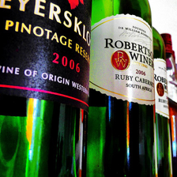

**예측:** `wine bottle` → `beer bottle`

**ReaL 판정:** 정답→오답 유지

**원본 validation ID:** `00003201` · 무작위 표본 case 24

| 항목 | 3H | 6H |
| --- | --- | --- |
| P(지정 정답) | 46.60% | 38.63% |
| P(6H 선택 클래스) | 26.23% | 48.40% |
| 지정 정답 순위 | 1 | 2 |
| 공식 구현의 Entropy | 1.189 | 0.873 |

**관찰:** 모델 입력의 병 라벨에 `WINE`, `PINOTAGE` 등의 글자가 보인다. 지정 정답인 와인병을 뒷받침하는 가시적 근거가 있고, ReaL도 와인병만 인정한다. 6H에서는 맥주병의 확률이 올라 순위가 역전됐다.

**해석의 한계:** 추가 계산 후 글자나 병의 어느 부분을 덜 활용했는지는 아직 알 수 없다. 글자가 있는 패치와 나머지 패치의 갱신 여부를 바꾸는 개입 실험의 후보로 삼을 수 있다.

### 6.2 점수판 → 화물차: 다른 범주로 높은 확률이 이동한 사례

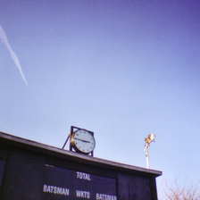

**예측:** `scoreboard` → `freight car`

**ReaL 판정:** 정답→오답 유지

**원본 validation ID:** `00028121` · 무작위 표본 case 19

| 항목 | 3H | 6H |
| --- | --- | --- |
| P(지정 정답) | 37.56% | 2.40% |
| P(6H 선택 클래스) | 2.61% | 79.05% |
| 지정 정답 순위 | 1 | 2 |
| 공식 구현의 Entropy | 1.618 | 0.455 |

**관찰:** 점수판에 `TOTAL`, `BATSMAN` 등의 글자가 보인다. 원본과 실제 입력에서 화물차를 뒷받침하는 뚜렷한 대상은 확인하지 못했다. ReaL도 화물차를 인정하지 않는다. 지정 정답 확률은 크게 낮아지고 화물차 확률은 높아졌다.

**해석의 한계:** 직사각형 외형이나 배경 때문에 혼동했을 가능성은 가설이다. 확률 변화만으로 혼동에 사용된 특징을 특정할 수 없다.

### 6.3 세면대 → 대걸레: 경쟁 후보가 올라간 사례

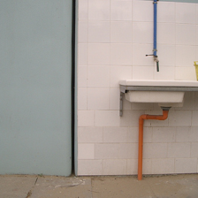

**예측:** `washbasin, handbasin, washbowl, lavabo, wash-hand basin` → `swab, swob, mop`

**ReaL 판정:** 정답→오답 유지

**원본 validation ID:** `00011577` · 무작위 표본 case 6

| 항목 | 3H | 6H |
| --- | --- | --- |
| P(지정 정답) | 29.38% | 17.87% |
| P(6H 선택 클래스) | 18.99% | 53.88% |
| 지정 정답 순위 | 1 | 2 |
| 공식 구현의 Entropy | 1.837 | 1.132 |

**관찰:** 벽에 붙은 세면대와 배관이 보인다. 원본도 확인했으나 뚜렷한 대걸레는 확인하지 못했다. ReaL은 세면대만 인정하며, 6H에서도 세면대는 2위로 남는다.

**해석의 한계:** 배관을 대걸레로 해석했다고 단정할 수는 없다. 실제 대상의 위치와 선택 토큰을 대조한 뒤 개입 실험이 필요하다.

### 6.4 페트리 접시 → iPod: 전처리 영향도 확인해야 하는 사례

| 원본 | 실제 모델 입력 |
| --- | --- |
| 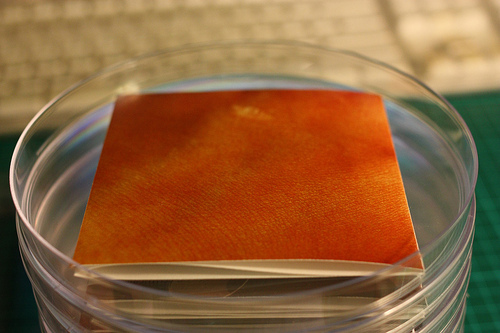 | 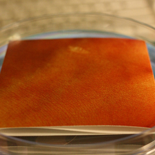 |

**예측:** `Petri dish` → `iPod`

**ReaL 판정:** 정답→오답 유지

**원본 validation ID:** `00035034` · 무작위 표본 case 21

| 항목 | 3H | 6H |
| --- | --- | --- |
| P(지정 정답) | 32.04% | 2.01% |
| P(6H 선택 클래스) | 0.15% | 30.21% |
| 지정 정답 순위 | 1 | 8 |
| 공식 구현의 Entropy | 1.727 | 1.704 |

**관찰:** 원본에는 원형 투명 접시가 보인다. 실제 입력에서는 주변이 잘려 주황색 직사각형 부분이 크게 차지한다. 6H에서 지정 정답은 8위로 내려간다. ReaL은 페트리 접시만 인정한다.

**해석의 한계:** 크롭이 실패를 일으켰다고 확정한 결과는 아니다. 3H도 동일한 크롭을 보았기 때문이다. 원본을 더 보존하는 전처리에서 두 단계의 예측을 다시 비교해야 한다.

### 6.5 두 마리의 개: 재검토 후에도 대상 선택이 애매한 사례

| 원본 | 실제 모델 입력 |
| --- | --- |
| 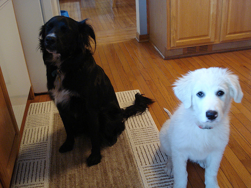 | 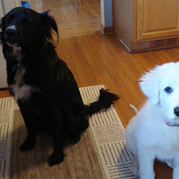 |

**예측:** `Great Pyrenees` → `flat-coated retriever`

**ReaL 판정:** 정답→오답 유지

**원본 validation ID:** `00004474` · 무작위 표본 case 11

| 항목 | 3H | 6H |
| --- | --- | --- |
| P(지정 정답) | 22.52% | 15.18% |
| P(6H 선택 클래스) | 12.01% | 21.80% |
| 지정 정답 순위 | 1 | 3 |
| 공식 구현의 Entropy | 1.875 | 1.825 |

**관찰:** 검은 개와 흰 개가 함께 있다. 실제 입력에서는 흰 개 얼굴 일부가 잘리고 검은 개는 크게 남는다. ReaL은 3H의 Great Pyrenees를 인정하고 6H의 flat-coated retriever는 인정하지 않는다.

**해석의 한계:** 이 판정만으로 6H가 사진 속 다른 개도 잘못 인식했다고 단정하지 않는다. 품종을 확정하지 않았으며, 어느 개에 근거해 예측했는지도 미확인이다. “두 라벨 기준 모두 악화”와 “사람에게도 명백한 실패”가 같지 않음을 보여준다.

### 6.6 커피 → 커피머신: 6H의 다른 대상 선택도 인정되는 사례

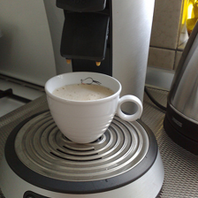

**예측:** `espresso` → `espresso maker`

**ReaL 판정:** 두 예측 모두 정답

**원본 validation ID:** `00032379` · 무작위 표본 case 15

| 항목 | 3H | 6H |
| --- | --- | --- |
| P(지정 정답) | 34.32% | 5.49% |
| P(6H 선택 클래스) | 20.81% | 83.70% |
| 지정 정답 순위 | 1 | 2 |
| 공식 구현의 Entropy | 1.496 | 0.415 |

**관찰:** 커피잔과 커피머신이 같은 입력에 함께 보인다. 공식 단일 정답은 espresso이므로 espresso maker는 오답이지만, ReaL은 두 예측을 모두 인정한다.

**해석의 한계:** 이 사례를 단순히 “6H가 이미지 이해에 실패했다”고 설명하기 어렵다. 커피의 정확한 종류를 외관만으로 확정한 것도 아니다. 공식 점수의 하락과 시각적 타당성을 구분해서 다룬다.

### 6.7 수영복 클래스: 라벨 기준에 따라 개선·악화가 뒤집히는 사례

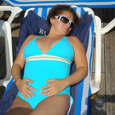

**예측:** `maillot` → `maillot, tank suit`

**ReaL 판정:** 오답→정답으로 판정 반전

**원본 validation ID:** `00013859` · 무작위 표본 case 12

| 항목 | 3H | 6H |
| --- | --- | --- |
| P(지정 정답) | 43.02% | 36.34% |
| P(6H 선택 클래스) | 26.14% | 49.02% |
| 지정 정답 순위 | 1 | 2 |
| 공식 구현의 Entropy | 1.257 | 0.902 |

**관찰:** 한 여성이 수영복과 선글라스를 착용한 사진이다. 공식 정답은 maillot(index 638), 6H 예측은 maillot, tank suit(index 639)다. ReaL은 639를 인정하지만 638은 인정하지 않아, 공식 기준의 악화가 재검토 기준에서는 교정으로 바뀐다.

**해석의 한계:** 사람이 클래스 이름만 보고 경계를 분명히 판정하기 어려운 사례다. 이 관찰만으로 원래 라벨이 확실히 잘못됐다고 선언하지 않는다.

### 6.8 디지털 시계 → 스톱워치: 판정을 유보하는 사례

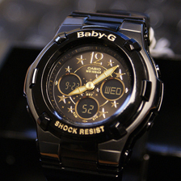

**예측:** `digital watch` → `stopwatch, stop watch`

**ReaL 판정:** 정답 목록 없음 · 평가 제외

**원본 validation ID:** `00013307` · 무작위 표본 case 14

| 항목 | 3H | 6H |
| --- | --- | --- |
| P(지정 정답) | 36.14% | 8.70% |
| P(6H 선택 클래스) | 35.50% | 63.38% |
| 지정 정답 순위 | 1 | 3 |
| 공식 구현의 Entropy | 1.285 | 0.818 |

**관찰:** 시계에 바늘과 숫자 표시가 함께 보인다. 외관만으로 기능과 클래스 경계를 확정하기 어렵다. 이 이미지의 ReaL 정답 목록은 비어 있어 재평가에서 제외된다.

**해석의 한계:** 빈 정답 목록은 두 예측이 모두 오답이라는 뜻이 아니다. 어느 쪽이 맞는지 임의로 결정하지 않으며, 명백한 실패 원인의 예시로 사용하지 않는다.

## 7. 어떤 클래스에서 오류가 많은가?

클래스별로 validation 이미지가 50장씩 있다. 아래는 **기존 게이트 적용 후 최종 오답 수**가 많은 클래스 일부이며, 정답→오답 945장만의 순위가 아니다.

| 클래스 | 최종 오답 / 50 | 오답률 |
| --- | --- | --- |
| laptop, laptop computer | 41 / 50 | 82.0% |
| screen, CRT screen | 40 / 50 | 80.0% |
| tiger cat | 39 / 50 | 78.0% |
| Appenzeller | 36 / 50 | 72.0% |
| letter opener, paper knife, paperknife | 36 / 50 | 72.0% |

최종 오답의 빈번한 혼동 쌍에는 laptop→notebook(32장), tub→bathtub(25장), sidewinder→horned viper(25장)가 있었다. 클래스별 50장이라는 작은 표본, 라벨 경계, 대상 크기와 이미지 구성 등의 영향을 함께 고려해야 한다. 이 순위를 일반적인 클래스 난이도로 확정하지 않는다.

3H Entropy 구간별로 추가 계산의 효과를 나누면 다음과 같다. “순증”은 구간 내 교정 수에서 악화 수를 뺀 값이다.

| 3H Entropy 구간 | 이미지 수 | 오답→정답 | 정답→오답 | 순증 | 게이트에서 6H 실행 |
| --- | --- | --- | --- | --- | --- |
| [0, 0.5) | 20,363 | 54 | 16 | +38 | 아니오 · 사후 비교 |
| [0.5, 1) | 11,633 | 814 | 284 | +530 | 아니오 · 사후 비교 |
| [1, 1.5) | 9,018 | 1,660 | 484 | +1,176 | 예 |
| [1.5, 2) | 6,909 | 2,008 | 387 | +1,621 | 예 |
| [2, 3) | 2,077 | 662 | 74 | +588 | 예 |

이 표는 기존 threshold의 집계이며 새로운 최적 threshold를 선택한 결과가 아니다. 특정 이미지에서 추가 계산이 도움이 될지는 Entropy 구간만으로 확정할 수 없다.

## 8. 선택적 토큰 갱신 실험에 대한 시사점

현재 결과는 **추가 계산이 모든 이미지에 동일한 효과를 주지 않는다**는 것을 보여준다. 그러나 어떤 토큰을 갱신해야 하는지, 선택적 갱신이 실제로 효과적인지는 아직 검증하지 않았다.

| 우선순위 | 후속 실험 | 확인할 내용 |
| --- | --- | --- |
| 1 | 토큰 100% 갱신 경로 검증 | 기존 6H 예측·정확도를 재현하는가? |
| 2 | 25/50/75% 갱신, Random과 CLS Attention 비교 | 선택적 계산이 정확도·추론시간을 개선하는가? |
| 3 | 공식 정답과 ReaL을 별도 평가 | 라벨의 애매함을 고려해도 결과 경향이 유지되는가? |
| 4 | 비교적 명확한 사례에서 영역별 갱신 개입 | 특정 영역의 갱신 여부가 예측 변화를 유발하는가? |

공식 Correction Retention의 기준 집합은 기존 게이트가 6H로 보내 교정한 **4,330장**, ReaL 기준 집합은 **3,330장**이다. 분모와 라벨 체계를 명시하고, 교정 유지율뿐 아니라 기존 6H가 맞힌 이미지에서 새로 발생한 오답도 측정한다. 기존 6H와의 예측 일치율도 보조 지표로 기록하되, 기존 오류까지 복제할 수 있으므로 정확도를 대체하지 않는다.

정답을 이용해 정의한 교정·악화 집합은 사후 진단용이다. 이를 배포 시 토큰 선택에 사용할 수는 없다. 사람이 판정하기 어려운 이미지를 임의로 재라벨링하거나 결과에서 제외하지 않는다.

## 9. 근거 파일과 재현 방법

### 9.1 공유하는 결과

| 파일 | 내용 |
| --- | --- |
| [stage_analysis.json](reports/2026-10-15/stage_analysis.json) | 전체 50,000장, 라우팅 집합별 전이 통계 |
| [failure_analysis.json](reports/2026-10-15/failure_analysis.json) | 기존 악화 945장의 순위·확률 및 혼동 통계 |
| [failure_audit.json](reports/2026-10-15/failure_audit.json) | ReaL 재평가, 동일 분모 정확도, Entropy 구간 통계 |
| [reassessment_transitions.csv](reports/2026-10-15/reassessment_transitions.csv) | 원래 판정과 ReaL 판정의 교차 집계 |
| [class_statistics.csv](reports/2026-10-15/class_statistics.csv) | 전체 클래스별 오류와 악화율의 분모 |
| [routed_error_pairs.csv](reports/2026-10-15/routed_error_pairs.csv) | 게이트 적용 후 전체 최종 오답의 혼동 쌍 |
| [regression_pairs.csv](reports/2026-10-15/regression_pairs.csv) | 실제 6H 진입 후 정답→오답의 혼동 쌍 |
| [visual_observations.csv](reports/2026-10-15/visual_observations.csv) | 무작위 40장의 비전문가 관찰 메모 |
| [illustrated_cases.json](reports/2026-10-15/illustrated_cases.json) | 본문 8장의 원본 ID, 확률·Top-5·라벨·이미지 해시 |

이미지 출처는 이 실험에 사용한 ImageNet-1K validation이다. 본문에는 사례 설명용 이미지 8장의 실제 모델 입력과 그중 2장의 원본을 포함했다. 원본 ID와 로컬 데이터 경로를 사례별 JSON에 남겼다.

### 9.2 실행

아래 명령은 저장소 루트에서 실행한다. 데이터·가중치·공식 백본 준비 방법은 [기본 README](../README.md)를 따른다. 이미지별 분석과 확률 재계산은 GPU가 필요하고, ReaL 대조는 저장된 결과만 사용한다.

```bash
# 각 실행이 출력한 실제 결과 폴더를 다음 단계에 전달한다.
CUDA_VISIBLE_DEVICES=0 .venv/bin/python baseline/analyze_stages.py --batch-size 128

CUDA_VISIBLE_DEVICES=0 .venv/bin/python baseline/analyze_failures.py \
  --source results/20261015T041255.578722Z-stage-analysis

.venv/bin/python baseline/audit_failures.py \
  --source results/20261015T041255.578722Z-stage-analysis \
  --failures results/20261015T043408.554317Z-failure-analysis \
  --real-labels .cache/reassessed-imagenet/real.json
```

`real.json`은 [고정한 ReaL 커밋의 파일](https://raw.githubusercontent.com/google-research/reassessed-imagenet/bcd006fe12e929f055e0ec7fe39dbf4d64a6881a/real.json)을 사용한다. 같은 폴더의 `source.json`에는 이 보고서의 `failure_audit.json` 안에 있는 `real_provenance` 객체를 저장한다. 실행 시 파일 해시를 대조한다.

원본 ImageNet 파일명의 ID로 ReaL에 연결한다. ImageFolder 순서나 HF Parquet 순서를 ReaL 배열 순서로 사용하면 안 된다. 이 실행에서는 **원본 ID 50,000개의 중복·누락 없음과 모든 원본 파일명 synset·정답 index의 일치**를 검사했다. ReaL의 빈 정답 목록은 오답으로 세지 않고 분모에서 제외했다.

```bash
.venv/bin/python -m unittest discover -s tests -p 'test_stage_analysis.py'
.venv/bin/python -m unittest discover -s tests -p 'test_failure_audit.py'
```

시각 점검 표본은 동일 seed로 재생성할 수 있지만, 관찰 메모는 자동 판정 결과가 아니다. 보고서에 사용한 메모는 CSV에 별도로 보존했다. 전체 이미지별 CSV·Attention·40장 갤러리는 로컬 `results/`에 있으며 저장소에 모두 포함하지 않는다.

### 9.3 출처와 버전

| 항목 | 값 |
| --- | --- |
| 공식 백본 커밋 | `9254c4950d3159937ad682592d58a2be69708c42` |
| 체크포인트 SHA256 | `9ead984e9e39887eb037a42c189c58c0af14cd9c2771ad27b4b01876997242b5` |
| ReaL 커밋 | `bcd006fe12e929f055e0ec7fe39dbf4d64a6881a` |
| ReaL JSON SHA256 | `d83e9bff374c631aae8439eb064c7019acc56e1b3bc3f56b8380c2a710b0220b` |
| 전체 예측 실행 | `20261015T041255.578722Z-stage-analysis` |
| 확률 재계산 실행 | `20261015T043408.554317Z-failure-analysis` |
| ReaL 및 무작위 점검 실행 | `20261015T045936.177850Z-failure-audit` |

실행 ID의 시각은 UTC이며 분석일 표기는 한국 시간 기준이다. 기존 전체 평가의 batch 512 결과와 본 보고서의 batch 128 결과는 작은 부동소수점 차이가 있을 수 있다. 본 보고서의 수치는 batch 128 분석 안에서 일관되게 비교했다.

## 10. CLS Attention 집중도와 패치 가리기 실험 — 2026-10-27

### 10.1 목적과 계산 정의

CLS가 높은 Attention을 주는 패치가 현재 1위 예측을 지지하는지, 경쟁 후보와 관련되는지 조사했다. 공식 전처리(224×224, crop_pct 0.9, bicubic, center crop)와 가중치는 그대로 유지했다. 이 실험은 토큰 선택 기준을 위한 진단이며, 선택적 토큰 갱신이나 fine-tuning의 성능 실험은 아니다.

기존 `20261015T041255.578722Z-stage-analysis`의 `narrow_cls_attention.npy`와 `images.csv`를 사용했다. 50,000개 고유 인덱스와 CSV의 `attention_row` 대응, 전체 Attention 확률 합을 확인했다.

3H 마지막 블록의 head 평균 CLS Attention에서 열 0(CLS 자체)을 제거하고 패치 열 1~196을 재정규화했다.

```text
p_i = attention_i / sum(attention_1 ... attention_196)
H_patch = -sum(p_i * ln(p_i))
T10 = sum(상위 10개 p_i)
```

Entropy는 자연로그 단위(nats)이며 최대는 `ln(196) ≈ 5.278`이다. 0인 항은 0으로 처리한다. 정규화한 Entropy `H_patch / ln(196)`도 CSV에 함께 저장했다. **이 Attention Entropy는 게이트에 쓰는 분류 출력 Entropy와 다른 값이다.**

### 10.2 기존 파일만 사용한 그룹 비교

| 그룹 | 이미지 수 | Attention H 평균 | H 중앙값 | Top-10 질량 평균 | Top-10 질량 중앙값 |
| --- | ---: | ---: | ---: | ---: | ---: |
| 3H 종료 | 31,996 | 4.1174 | 4.1405 | 47.58% | 47.43% |
| 6H 진입 | 18,004 | 4.3992 | 4.4273 | 39.13% | 38.54% |
| 6H 진입 중 오답→정답 | 4,330 | 4.4087 | 4.4373 | 38.74% | 38.21% |
| 6H 진입 중 정답→오답 | 945 | 4.4031 | 4.4274 | 39.22% | 38.76% |

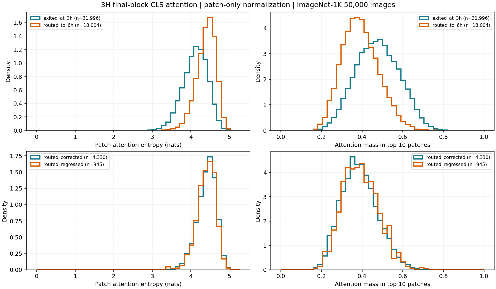

히스토그램은 하나의 그림에 두 지표와 두 비교를 배치했다. 표본 수가 다르므로 빈도 대신 밀도를 사용하고, 지표별 동일한 bin 경계를 적용했다.

3H 종료 집합은 6H 진입 집합보다 Attention이 더 집중됐다. 반면 교정·악화 집합의 평균 H 차이는 약 0.00565 nats, Top-10 질량 차이는 약 0.48%p로 작고 분포가 크게 겹친다. **집중도만으로 6H의 교정과 악화를 구분할 근거는 약하다.** 이 집계는 새로운 게이트의 성능이나 인과관계를 검증한 결과가 아니다.

### 10.3 실패 분석 6절의 8장 Attention 지도

아래는 6절과 동일한 8장의 실제 모델 입력 위에 3H CLS Attention을 겹친 결과다. 14×14 값을 각 16×16픽셀 셀에 그대로 표시했으며 보간·평활화를 하지 않았다. 원본 이미지 기여율은 0.6, 색상 지도는 0.4다. 모든 이미지에 **동일한 색상 범위 0~0.19488**을 사용해 이미지별 최댓값 정규화에 따른 착시를 피했다. 색이 밝을수록 재정규화한 Attention 값이 크다.

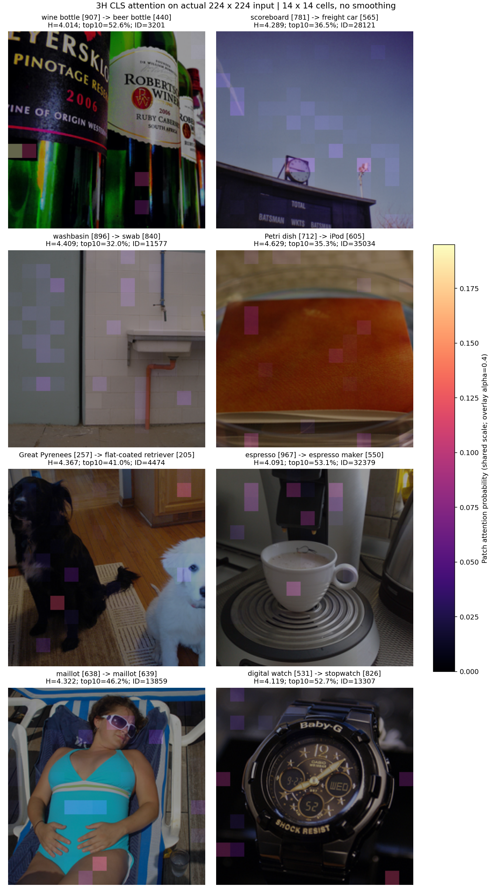

| 사례 | H (nats) | Top-10 질량 | 개별 오버레이 |
| --- | ---: | ---: | --- |
| 와인병→맥주병 | 4.0138 | 52.56% | [이미지](reports/2026-10-27/overlays/wine_bottle_attention.png) |
| 점수판→화물차 | 4.2886 | 36.48% | [이미지](reports/2026-10-27/overlays/scoreboard_attention.png) |
| 세면대→대걸레 | 4.4094 | 31.97% | [이미지](reports/2026-10-27/overlays/washbasin_attention.png) |
| 페트리 접시→iPod | 4.6287 | 35.31% | [이미지](reports/2026-10-27/overlays/petri_dish_attention.png) |
| Great Pyrenees→flat-coated retriever | 4.3668 | 41.04% | [이미지](reports/2026-10-27/overlays/two_dogs_attention.png) |
| espresso→espresso maker | 4.0914 | 53.09% | [이미지](reports/2026-10-27/overlays/espresso_attention.png) |
| maillot 638→maillot 639 | 4.3221 | 46.25% | [이미지](reports/2026-10-27/overlays/maillot_attention.png) |
| digital watch→stopwatch | 4.1192 | 52.72% | [이미지](reports/2026-10-27/overlays/watch_attention.png) |

Attention은 정답 클래스에 대한 기여도 지도와 같지 않다. 마지막 블록의 패치 특징에는 이전 블록에서 다른 패치와 교환한 정보가 포함되므로, 특정 좌표의 높은 Attention을 그 위치의 원본 픽셀만이 원인이라는 뜻으로 읽지 않는다. 8개 사례의 개별 14×14 배열도 같은 `overlays/` 폴더에 NPY로 저장했다.

### 10.4 GPU 가리기 실험의 방법

기존 6H 진입 대상 18,004장을 dataset_index로 정렬한 뒤 seed `20261027`로 **200장을 균등 무작위 비복원 추출**했다. 표본은 정답 유지 71장, 두 단계 오답 66장, 교정 45장, 악화 18장이다. 위의 8장만을 실험한 것이 아니다.

각 이미지에서 저장된 3H Attention 상위 10개 패치를 선택했다. 패치 하나를 가릴 때마다 원래 이미지에서 시작하며, 누적해서 가리지 않았다. 공식 정규화가 끝난 입력에서 해당 16×16 영역의 3채널을 0으로 바꿨다. 이는 RGB 공간의 정규화 평균색에 해당하며 검은색 마스크가 아니다.

가리기 전 3H의 1위 클래스 `c1`, 2위 클래스 `c2`를 고정하고, 가린 후 순위가 바뀌어도 같은 두 클래스의 logit을 사용했다.

```text
m_before = z_before[c1] - z_before[c2]
m_after  = z_after[c1]  - z_after[c2]
delta_m  = m_after - m_before

delta_m < 0: 가리면 1위 우위가 약해짐 → 원래 1위 상대 지지
delta_m > 0: 가리면 1위 우위가 강해짐 → 원래 1위 우위에 반대하는 방향
```

각 이미지당 동일한 무가림 입력 2개와 독립 가림 10개를 한 배치로 실행했다. 3H만 실행했고 6H는 재실행하지 않았다. GPU 0의 RTX 3090, FP32, AMP off, TF32 allowed 조건이다. **원래 CSV의 3H Top-1은 200장 모두 재현**됐고, 두 무가림 입력의 margin 차이는 전부 0이었다.

### 10.5 가리기 결과

요청한 부호 기준으로 2,000개 독립 가리기를 분류하면 다음과 같다. 각 이미지가 10패치씩 기여하므로 패치 비율은 이미지별 비율의 평균과 같다.

| 부호 기준 | 패치 수 / 2,000 | 비율 |
| --- | ---: | ---: |
| 차이가 줄어듦: 1위 상대 지지 | 939 | 46.95% |
| 차이가 늘어남: 1위 우위에 반대 | 1,061 | 53.05% |
| 정확히 변화 없음 | 0 | 0.00% |

아주 작은 변화를 별도로 처리하기 위해 `epsilon = max(1e-4, 10 × 무가림 margin 최대 오차)`도 적용했다. 이번에는 epsilon=0.0001이며, 양수 1개가 거의 변화 없음으로 분류됐다.

| 원래 3H→6H 그룹 | 이미지 수 | 가린 패치 수 | 1위 상대 지지 | 1위 우위에 반대 | 거의 변화 없음 |
| --- | ---: | ---: | ---: | ---: | ---: |
| 전체 | 200 | 2,000 | 46.95% | 53.00% | 0.05% |
| 정답 유지 | 71 | 710 | 45.21% | 54.79% | 0.00% |
| 둘 다 오답 | 66 | 660 | 43.64% | 56.21% | 0.15% |
| 오답→정답 | 45 | 450 | 54.44% | 45.56% | 0.00% |
| 정답→오답 | 18 | 180 | 47.22% | 52.78% | 0.00% |

이미지별 Top-10 중 1위 상대 지지 비율의 평균·중앙값은 **46.95%·40%**, 반대 방향 비율은 **53.00%·60%**였다. 2,000개 delta_m의 평균은 **−0.00815**, 중앙값은 **+0.01000**, 절댓값 평균은 **0.21579 logit**이었다. 따라서 부호의 개수와 변화 크기를 함께 보아야 한다. 158회(7.9%)의 가리기에서 Top-1이 다른 클래스로 바뀌었으며, 반드시 원래 2위로 바뀐다는 뜻은 아니다.

같은 이미지의 10패치는 독립 표본이 아니므로 **이미지 200장을 단위로** 10,000회 bootstrap(seed 20261027)을 수행했다. 허용 오차 적용 후 비율의 95% percentile 구간은 1위 상대 지지 **42.50~51.55%**, 반대 방향 **48.40~57.45%**다. 어느 방향이 전체 모집단에서 확실히 더 많다고 결론 내리기 어렵고, 특히 악화 집합은 18장뿐이므로 그룹 간 차이를 확정하지 않는다.

### 10.6 “정답 근거”와 “헷갈림”에 대한 해석

**높은 Attention을 받은 패치가 모두 현재 1위를 지지하는 것은 아니었다.** 그러나 다음 이유로 이를 “정답 패치 46.95%, 헷갈리는 패치 53.05%”라고 부를 수는 없다.

1. 표본 200장 중 원래 3H의 1위가 정답인 이미지는 89장이다. 1위가 틀린 111장 중 원래 2위가 정답인 이미지는 39장이다. 따라서 1위 지지/2위 상대 지지를 정답/오답과 동일시할 수 없다.
2. margin은 두 logit의 차이다. 허용 오차 기준 양수 1,060개 중 156개는 **가린 뒤 두 logit이 모두 낮아졌지만 2위가 더 낮아져서** 차이가 커졌다. 이것만으로 해당 패치가 2위만의 근거라고 할 수 없다. 각 logit의 변화도 CSV에 기록했다.
3. 입력 패치를 평균색으로 바꾸는 것은 전체 네트워크의 입력을 바꾸는 개입이다. 마지막 블록 Attention과 같은 위치의 픽셀 기여를 직접 동일시할 수 없으며, 가림에 따른 입력 분포 변화도 포함된다.
4. 입력 패치를 가리는 실험은 그 토큰의 **6H 갱신을 생략하는 실험과 다르다.** 이 결과로 어떤 토큰을 동결해야 하는지 확정할 수 없다.
5. Random 패치나 Attention 하위 패치와의 비교는 이번에 수행하지 않았다. 따라서 상위 패치가 다른 패치보다 중요하거나 덜 중요하다는 상대적 결론은 아직 없다.

현재 결과로는 **CLS Attention을 곧바로 “정답 근거 점수”로 사용하는 해석을 보류**하는 것이 타당하다. Attention Top-K는 비교 기준으로 유지하되, Random 선택과 실제 선택적 갱신의 효과를 비교해야 한다. margin 변화의 부호와 크기는 사후 진단 신호로 활용할 수 있지만, 10번의 추가 추론을 요구하므로 그대로 경량 배포 게이트로 사용할 수는 없다.

### 10.7 결과 파일과 재현

| 파일 | 내용 |
| --- | --- |
| [attention_groups.csv](reports/2026-10-27/attention_groups.csv) | 그룹별 평균·중앙값·표준편차 |
| [attention_statistics.json](reports/2026-10-27/attention_statistics.json) | 정의·원본 파일 해시·CPU 집계 |
| [overlay_cases.json](reports/2026-10-27/overlay_cases.json) | 8장 행 대응·공통 색상 범위 |
| [occlusion_summary.json](reports/2026-10-27/occlusion_summary.json) | 그룹별 가리기 결과·환경·실행 코드 해시 |
| [occlusion_sample_indices.json](reports/2026-10-27/occlusion_sample_indices.json) | 200장 표본 인덱스와 seed |
| [occlusion_images.csv](reports/2026-10-27/occlusion_images.csv) | 이미지별 상위 10패치의 분류 비율 |
| [occlusion_patches.csv](reports/2026-10-27/occlusion_patches.csv) | 2,000개 패치 좌표·Attention·고정 클래스·가리기 전후 logit·차이 |
| [occlusion_supplement.json](reports/2026-10-27/occlusion_supplement.json) | 이미지 단위 bootstrap 구간·1위/2위와 정답의 관계 |

```bash
.venv/bin/python -m pip install -r requirements-analysis.txt

# GPU 불필요: 50,000장 통계, 히스토그램 한 그림, 8장 오버레이
.venv/bin/python baseline/analyze_attention.py \
  --source results/20261015T041255.578722Z-stage-analysis \
  --output results/20261027-attention-analysis

# GPU 필요: 200장 × 10개 독립 패치 가리기
CUDA_VISIBLE_DEVICES=0 .venv/bin/python baseline/occlude_attention.py \
  --source results/20261015T041255.578722Z-stage-analysis \
  --output results/20261027-attention-occlusion \
  --samples 200 --seed 20261027

.venv/bin/python -m unittest discover -s tests -p test_attention_experiments.py
```

이미지별 50,000장 Attention 지표는 로컬 `results/20261027-attention-analysis/image_metrics.csv`에 있다. 8장 모델 입력의 해시와 원본 예측 ID, 가리기의 비누적성·패치 위치·부호 분류를 검증했다.
