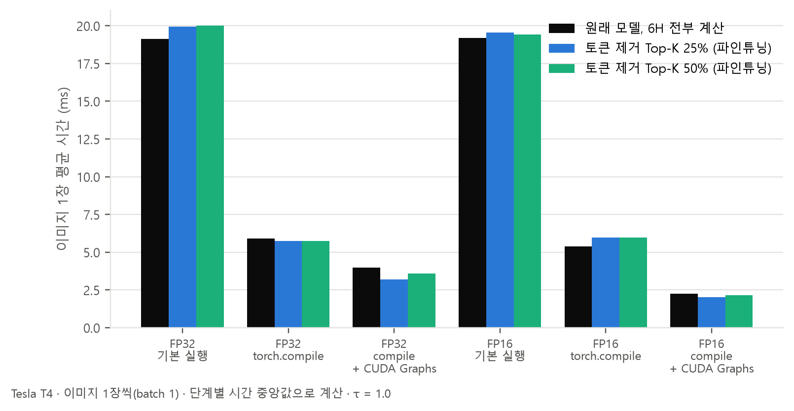
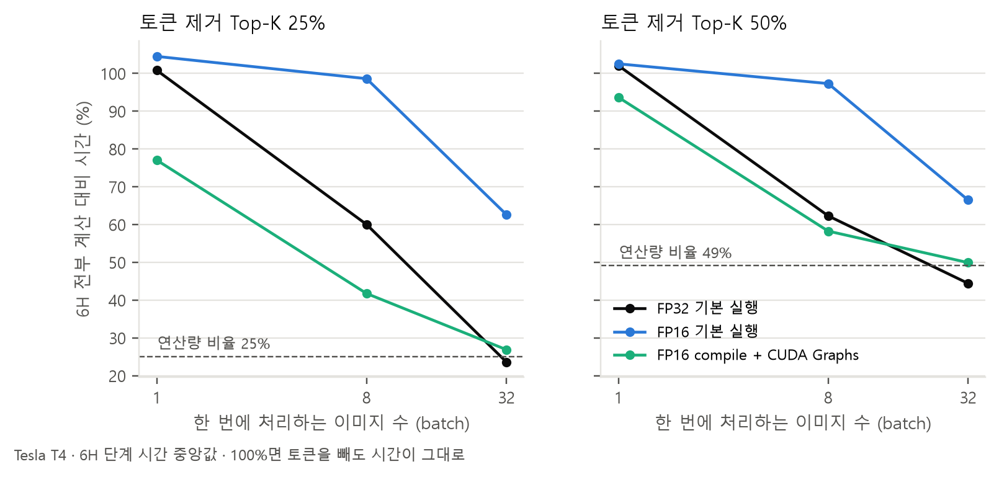

# 실험 2. GPU 최적화: 같은 모델을 더 빨리 돌릴 수 있나

2026-11-08 · 장준용 · Kaggle Tesla T4 (torch 2.11) · ImageNet-1K 검증 5만 장 · 재학습 없음

## 한눈에 보기

- torch.compile과 CUDA Graphs를 같이 쓰면 사진 한 장(τ = 1.0) 추론이 기본 실행 19.1 ms에서 FP32 4.0 ms, FP16 2.3 ms로 줄었다. 각각 4.8배, 8.5배 빨라졌다. 기본 실행에서는 GPU에 명령을 내리는 시간이 계산 시간보다 훨씬 길었다.
- 이렇게 바꾸고 나서야 토큰 제거가 GPU에서도 시간을 줄였다. FP32에서 원래 모델이 3.98 ms, 토큰 제거 Top-K 25%(파인튜닝)가 3.20 ms다. 기본 실행에서는 토큰을 빼도 19.1 → 19.9 ms로 오히려 늘었다.
- 같은 시간을 쓰는 원래 모델과 정확도를 비교하면, 기본 실행에서는 토큰 제거가 2.3%p 손해였다. 최적화 후에는 25%가 +0.13%p(차이 없음), 50%가 +0.23%p(95% 구간 +0.05 ~ +0.43)였다. 손해는 사라졌지만 계산량 기준에서 본 +2.4%p 이득은 사진 한 장씩 처리하는 GPU에서는 아직 시간으로 거의 돌아오지 않는다.
- 사진 32장을 한 번에 처리하면 토큰 25%만 남긴 6H가 전부 계산의 24~27% 시간으로 끝난다. 계산을 줄인 만큼 시간이 준다.
- FP16으로 바꿔도 정확도는 거의 그대로다. 5만 장 중 답이 바뀐 사진은 11~248장이고 전체 정확도 차이는 0.03%p 이하다.

## 1. 왜 이 실험을 했나

11/3 실험 7에서 토큰 제거 방식으로 파인튜닝한 모델은 같은 계산량의 τ 조절보다 2.4%p 더 정확했다. CPU에서는 시간도 그만큼 줄었다. 그런데 GPU(RTX 4090)에서 사진을 한 장씩 넣으면 시간이 그대로였다. 원래 모델이 5.5 ms, 토큰 제거가 5.7 ms였다([`h1_diagnosis.md` 실험 5](h1_diagnosis.md#실험-5-실제로-빨라지나--cpu는-빨라지고-gpu는-아니다)).

그때 세운 설명은 이렇다. PyTorch는 기본적으로 연산 하나마다 CPU가 GPU에 명령을 하나씩 보내는데, ViT를 한 번 돌리면 이런 명령이 수백 개 나간다. 사진 한 장은 계산이 금방 끝나서 GPU가 다음 명령을 기다리는 시간이 더 길다. 그러면 토큰을 빼서 계산을 줄여도 시간은 줄지 않는다.

그래서 세 가지를 확인했다.

1. 명령 내리는 비용을 줄이면 전체가 빨라지나?
2. 그러면 토큰 제거가 GPU에서도 시간을 아끼게 되나?
3. FP16으로 바꿔도 정확도가 유지되나?

## 2. 무엇을 바꿔 봤나

| 실행 방식 | 하는 일 |
| --- | --- |
| 기본 실행 (eager) | 연산마다 GPU에 명령을 하나씩 보낸다. 지금까지 모든 측정이 이 방식이었다. |
| torch.compile | 연산 여러 개를 하나로 합쳐 명령 수를 줄인다. |
| CUDA Graphs | 명령 순서를 한 번 녹화해 두고, 다음부터 녹화본을 한 번에 다시 보낸다. |
| torch.compile + CUDA Graphs | 둘 다 쓴다 (`torch.compile(mode="reduce-overhead")`). |

숫자 형식은 FP32(32비트)와 FP16(16비트) 두 가지로 쟀다. FP16에서는 모델 가중치와 입력을 모두 16비트로 바꿨다.

**측정 방법.** 추론을 단계로 나눠 단계마다 300번 재고 중앙값을 썼다. 단계는 3H, 3H + attention(토큰을 고르려면 3H의 CLS attention을 꺼내야 한다), 6H 전부 계산, 6H 토큰 제거 Top-K 25/50/75%다. 사진 한 장의 평균 시간은 τ = 1.0 기준으로 "3H + (6H로 가는 비율 36%) × 6H"로 계산했다. 토큰 제거일 때는 3H 대신 3H + attention을 넣었다. 전처리와 CPU→GPU 이미지 복사는 뺐다.

**코드를 두 군데 고쳤다.** CUDA Graphs는 "GPU가 끝날 때까지 CPU가 기다리는" 코드가 있으면 녹화할 수 없다.

- 토큰을 고르던 `mask.nonzero()`는 남길 토큰 수를 CPU가 알아야 해서 GPU를 기다린다. 크기가 정해진 `topk` + `sort`로 바꿨다. 결과(logits)가 원래 코드와 같은지 먼저 확인한다.
- 엔트로피 계산에 쓰는 `Categorical`은 입력 확률을 검사하면서 GPU를 기다린다. 이 검사를 껐다. 계산값은 바뀌지 않는다. FP16에서는 확률 합이 1에서 조금 어긋나 이 검사에 걸리기도 해서 정확도 평가 코드에서도 껐다.

**GPU가 T4인 이유.** 문화관 PC(RTX 4090)가 11/5 밤부터 꺼져 있어 Kaggle의 무료 T4에서 쟀다. 그래서 시간 숫자는 11/3의 4090 숫자와 직접 비교할 수 없다. 이 문서의 비교는 모두 같은 T4 안에서 했다. T4에는 TF32가 없어 FP32는 순수 FP32로 계산된다. 정확도도 T4에서 FP32와 FP16을 둘 다 다시 쟀다. FP32 정확도는 4090 결과와 0.01%p 안에서 같다(τ = 1.0 원래 모델 80.30%, 파인튜닝 토큰 제거 25% 78.43%).

## 3. 결과

### 3-1. 명령 내리는 비용을 줄이면 빨라지나 → 4.8 ~ 8.5배 빨라진다

| 단계별 시간, 사진 1장 (ms) | 3H | 3H + attention | 6H 전부 | 6H 토큰 제거 25% | 50% | 75% |
| --- | ---: | ---: | ---: | ---: | ---: | ---: |
| FP32 기본 실행 | 13.26 | 14.02 | 16.25 | 16.38 | 16.58 | 16.41 |
| FP32 torch.compile | 4.19 | 4.37 | 4.81 | 3.85 | 3.83 | 4.01 |
| FP32 compile + CUDA Graphs | 2.24 | 2.35 | 4.85 | 2.36 | 3.41 | 4.03 |
| FP16 기본 실행 | 13.54 | 13.62 | 15.67 | 16.38 | 16.07 | 15.99 |
| FP16 torch.compile | 4.02 | 4.58 | 3.79 | 3.89 | 3.86 | 3.88 |
| FP16 compile + CUDA Graphs | 1.60 | 1.53 | 1.83 | 1.41 | 1.71 | 1.78 |



| 사진 1장 평균 시간, τ = 1.0 (ms) | 원래 모델 | 토큰 제거 Top-K 25% | 토큰 제거 Top-K 50% |
| --- | ---: | ---: | ---: |
| FP32 기본 실행 | 19.12 | 19.94 | 20.01 |
| FP32 torch.compile | 5.92 | 5.76 | 5.75 |
| FP32 compile + CUDA Graphs | 3.98 | **3.20** | 3.58 |
| FP16 기본 실행 | 19.19 | 19.54 | 19.43 |
| FP16 torch.compile | 5.39 | 5.99 | 5.98 |
| FP16 compile + CUDA Graphs | 2.26 | **2.03** | 2.14 |

- 기본 실행에서는 3H만 해도 13 ms인데, compile + CUDA Graphs로는 1.6 ~ 2.2 ms다. 같은 계산이 1/6 ~ 1/8 시간에 끝났으니, 기본 실행 시간의 대부분은 계산이 아니라 명령을 내리는 시간이었다.
- torch.compile만 써도 3배 넘게 빨라진다(19.1 → 5.9 ms). CUDA Graphs를 더하면 FP32 4.0 ms, FP16 2.3 ms까지 내려간다.
- FP16은 기본 실행이나 torch.compile만 쓸 때는 FP32와 비슷하다. 명령 내리는 비용이 계산 비용을 가리기 때문이다. 이 비용을 걷어 낸 compile + CUDA Graphs에서는 FP32보다 43% 빨랐다(3.98 → 2.26 ms).
- torch.compile은 처음 실행할 때 준비 시간이 든다. 사진 한 장 기준으로 단계마다 8 ~ 17초였고 32장을 한 번에 넣는 토큰 제거 단계는 77초, 467초까지 걸렸다. 앱을 켤 때 한 번 드는 비용이다.

### 3-2. 토큰 제거가 GPU에서도 시간을 아끼게 되나 → 아끼지만, 정확도 이득은 아직 작다

토큰 제거가 "같은 시간"에서도 나은지 보려고, 원래 모델이 토큰 제거와 같은 시간을 쓰도록 6H로 보내는 사진 수를 맞췄다. 엔트로피가 높은 사진부터 6H로 보냈다(11/3의 같은 계산량 비교 방법을 시간에 적용했다). 그다음 사진마다 정답 여부를 짝지어 비교하고 부트스트랩으로 95% 구간을 냈다. 토큰 제거 쪽은 파인튜닝한 모델을 썼다.

| 같은 시간에서 비교 | 25%: 원래 모델 → 토큰 제거 | 차이 (95% 구간) | 50%: 원래 모델 → 토큰 제거 | 차이 (95% 구간) |
| --- | ---: | ---: | ---: | ---: |
| FP32 기본 실행 | 80.73% → 78.43% | −2.30 (−2.51 ~ −2.08) | 80.77% → 79.67% | −1.10 (−1.27 ~ −0.92) |
| FP32 torch.compile | 79.99% → 78.43% | −1.56 (−1.77 ~ −1.34) | 79.97% → 79.67% | −0.30 (−0.48 ~ −0.12) |
| FP32 compile + CUDA Graphs | 78.30% → 78.43% | +0.13 (−0.10 ~ +0.37) | 79.43% → 79.67% | **+0.23 (+0.05 ~ +0.43)** |
| FP16 기본 실행 | 80.51% → 78.42% | −2.08 (−2.30 ~ −1.87) | 80.46% → 79.65% | −0.81 (−0.98 ~ −0.64) |
| FP16 torch.compile | 81.28% → 78.42% | −2.85 (−3.09 ~ −2.61) | 81.27% → 79.65% | −1.61 (−1.81 ~ −1.41) |
| FP16 compile + CUDA Graphs | 78.91% → 78.42% | −0.49 (−0.72 ~ −0.25) | 79.64% → 79.65% | +0.01 (−0.16 ~ +0.19) |

- 기본 실행에서는 토큰 제거가 2%p 넘게 손해다. 4090에서 본 모습(−2.1 / −0.9%p)과 같다. 토큰을 빼도 시간이 안 줄고 attention을 꺼내는 시간만 늘어서 같은 시간이면 원래 모델이 사진을 더 많이 6H로 보낼 수 있기 때문이다.
- compile + CUDA Graphs에서는 손해가 사라졌다. FP32 50%는 근소하게 앞선다(+0.23%p).
- 그래도 계산량 기준 +2.4%p에 비하면 작다. 이유는 두 가지다.
  - 사진 한 장 시간의 대부분이 3H다. FP16 compile + CUDA Graphs에서 2.26 ms 중 1.60 ms가 3H이고 6H 몫은 0.66 ms뿐이다. 토큰 제거는 이 0.66 ms 안에서만 시간을 줄일 수 있다.
  - 토큰을 25%만 남겨도 6H 시간은 전부 계산의 49%(FP32), 77%(FP16)다. 계산량은 25%로 줄었는데, 사진 한 장으로는 GPU를 다 못 채워 시간은 그만큼 줄지 않는다.
- FP16 torch.compile에서만 토큰 제거가 더 느렸다(5.39 → 5.99 ms). 이 설정에서는 3H + attention이 3H보다 0.56 ms 느렸고 6H는 토큰을 빼도 거의 같았다(3.79 vs 3.89 ms).

### 3-3. 여러 장을 한 번에 처리하면 → 계산을 줄인 만큼 시간이 준다

| 6H 시간 (전부 계산 = 100%) | 토큰 제거 25%: 1장 / 8장 / 32장 | 토큰 제거 50%: 1장 / 8장 / 32장 |
| --- | ---: | ---: |
| 계산량 비율 (이론) | 25% | 49% |
| FP32 기본 실행 | 101% / 60% / **24%** | 102% / 62% / 44% |
| FP16 기본 실행 | 104% / 99% / 63% | 103% / 97% / 66% |
| FP16 compile + CUDA Graphs | 77% / 42% / **27%** | 94% / 58% / 50% |



- 32장을 한 번에 넣으면 GPU가 계산으로 꽉 차서 토큰 25%만 남긴 6H가 24 ~ 27% 시간에 끝난다. 계산량 비율(25%)과 거의 같다.
- FP16 기본 실행은 32장에서도 63%다. FP16은 계산이 빨라서 32장으로도 명령 내리는 비용이 아직 크다. compile + CUDA Graphs를 더하면 27%로 내려간다.
- 서버처럼 사진을 모아서 처리할 수 있다면 토큰 제거의 계산 절약이 GPU에서도 시간 절약이 된다.

### 3-4. FP16으로 바꿔도 정확도가 유지되나 → 유지된다

| 전체 정확도 (T4) | 3H만 | τ = 1.0, 6H 전부 | τ = 1.0, 토큰 제거 25% | τ = 1.0, 토큰 제거 50% |
| --- | ---: | ---: | ---: | ---: |
| 원래 모델 FP32 | 73.54% | 80.30% | 73.81% | 78.60% |
| 원래 모델 FP16 | 73.54% | 80.31% | 73.79% | 78.63% |
| 파인튜닝 모델 FP32 | 73.60% | 79.98% | 78.43% | 79.67% |
| 파인튜닝 모델 FP16 | 73.60% | 79.98% | 78.42% | 79.65% |

| FP32 → FP16에서 답이 바뀐 사진 (5만 장 중) | 6H로 보낼지 판단 | 3H | 6H 전부 | 토큰 제거 25% | 토큰 제거 50% |
| --- | ---: | ---: | ---: | ---: | ---: |
| 원래 모델 | 32 | 36 | 21 | 248 | 96 |
| 파인튜닝 모델 | 26 | 28 | 11 | 125 | 75 |

- 정확도 차이는 0.03%p 이하다. 바뀐 사진들도 맞던 게 틀리고 틀리던 게 맞아서 서로 상쇄된다.
- 토큰 제거에서 바뀐 사진이 조금 더 많다. 3H attention 값이 조금만 달라져도 고르는 토큰이 바뀌기 때문으로 보인다. 파인튜닝 모델에서는 그 수가 절반으로 줄었다.

## 4. 정리

- 이번 실험에서 GPU 시간을 가장 크게 줄인 건 토큰 제거가 아니라 실행 방식이었다. torch.compile + CUDA Graphs는 코드 몇 줄로 시간을 4.8 ~ 8.5배 줄였고 FP16은 정확도를 거의 잃지 않았다.
- 토큰 제거는 실행 방식을 바꾼 뒤에야 GPU에서 시간을 줄였다. 사진 한 장씩 처리하면 이득이 작다(같은 시간에서 0 ~ +0.2%p). 여러 장을 모으면 계산을 줄인 만큼 시간이 준다.
- 11/3 결과와 합치면 이렇다. CPU(휴대폰과 비슷한 환경)에서는 토큰 제거가 그대로 시간 절약이 된다. GPU에서는 실행 방식을 먼저 최적화해야 하고 사진을 모아 처리할 때 효과가 크다.

## 5. 한계

- T4 한 종류에서만 쟀다. 4090 결과와 직접 비교할 수 없고 실제 휴대폰이나 Jetson 같은 기기는 재지 않았다. Kaggle 서버의 CPU가 느린 편이라 기본 실행에서 명령 내리는 비용이 일반 PC보다 크게 나왔을 수 있다. 4090 PC에서 기본 실행 3H는 약 4 ms였다.
- CUDA Graphs만 따로 쓴 경우는 모든 단계에서 녹화에 실패했다(`Cannot copy between CPU and CUDA tensors during CUDA graph capture`). 모델 코드가 CPU 텐서를 쓰지 않는 것은 확인했다. GPU 연산 하나가 내부에서 복사를 하는 것으로 보이지만 어느 연산인지는 아직 못 찾았다. torch.compile을 거치면 녹화가 된다.
- 시간은 단계별 중앙값을 더한 추정치다. 실제로 사진마다 6H로 보낼지 정하려면 엔트로피를 CPU로 읽어야 하는데, 이때 GPU를 기다리는 시간은 포함하지 않았다.
- 파인튜닝 모델은 하나(시드 42)뿐이다.

## 재현

Kaggle 노트북(GPU T4, 인터넷 끔)으로 돌렸다. 코드, 공식 가중치, 파인튜닝 가중치를 비공개 데이터셋 하나(`ondevice.tar`)로 올렸다. ImageNet 검증 이미지는 Kaggle의 ILSVRC 대회 데이터에서 가져와 `evaluate_drop.py`가 읽는 클래스 폴더(0000 ~ 0999)로 연결한다. 이렇게 하면 클래스 안의 사진 순서는 HF에서 받은 데이터와 다르다. 그래서 FP32와 FP16 정확도를 둘 다 T4에서 같은 순서로 쟀다.

```bash
# 각 파일이 Kaggle 노트북 하나 (scripts/kaggle_exp2/)
latency.py   # baseline/optimize_latency.py: 단계별 시간, 약 26분
fp16.py      # baseline/evaluate_drop.py --fp16: 원래 모델, 파인튜닝 모델, 약 11분
fp32.py      # baseline/evaluate_drop.py: 같은 사진 순서의 FP32, 약 25분
# 분석과 그림
cd baseline && python analyze_exp2.py --latency <latency 결과> --official <fp32 원래> --finetuned <fp32 파인튜닝> \
  --official-fp16 <fp16 원래> --finetuned-fp16 <fp16 파인튜닝> --output reports/2026-11-08
```

- 4090 PC에서는 `CUDA_VISIBLE_DEVICES=0 .venv/bin/python baseline/optimize_latency.py`, `baseline/evaluate_drop.py --fp16 [--weights ...]`로 같은 실험을 돌릴 수 있다.
- `reports/2026-11-08/`에는 그림 2장, 핵심 수치 `exp2_key_numbers.json`, 단계별 시간 원자료 `exp2_latency.json`, T4 정확도 요약 4개가 있다.
