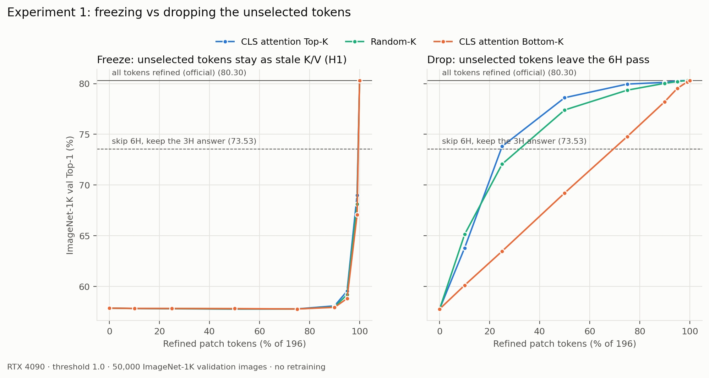
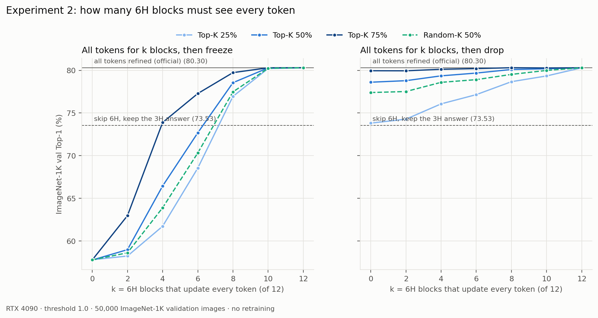
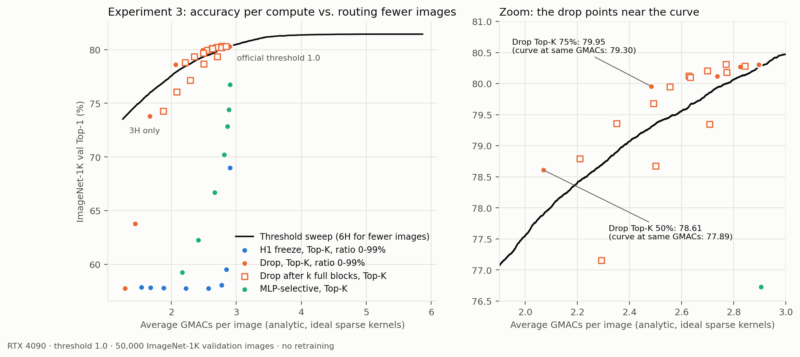
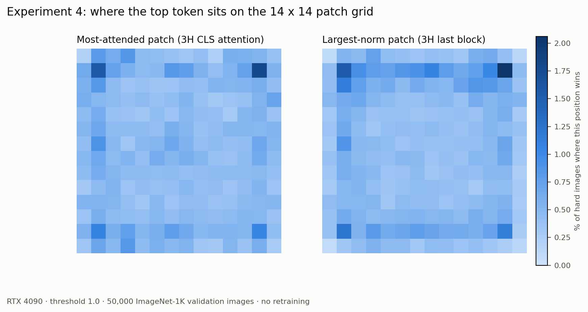
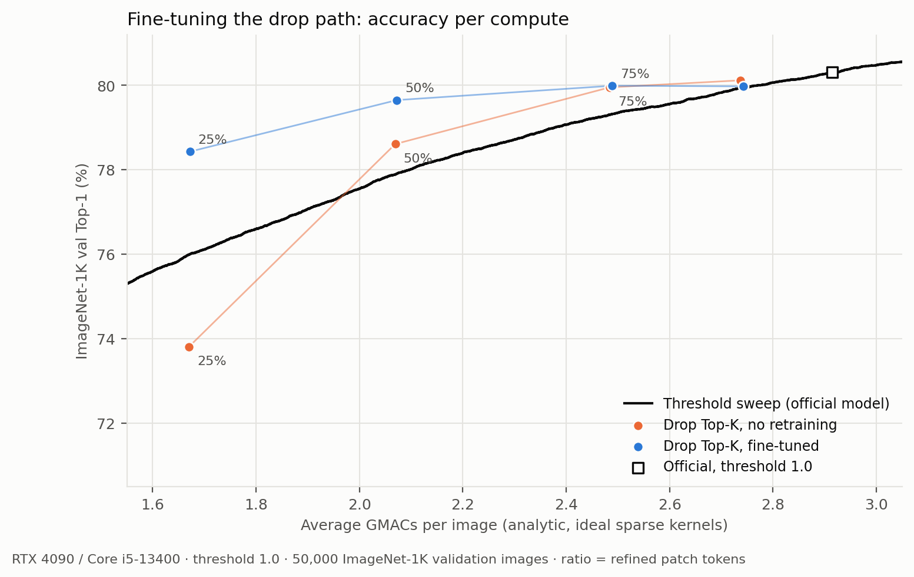

# H1 진단: 토큰을 덜 계산하면 왜 무너지고, 어떻게 하면 안 무너지나

2026-11-02 진단(실험 1~4, 재학습 없음) · 2026-11-03 후속(실험 5~7) · RTX 4090(문화관 AIX408-20) · ImageNet-1K 검증 5만 장

## 한눈에 보기

- H1이 무너진 원인은 **계산을 덜 해서가 아니라, 다시 계산하지 않은 낡은 토큰이 섞여서**였다. 그 토큰을 아예 빼면 학습 없이도 정확도가 거의 돌아온다. 50%만 계산할 때 어려운 사진 정확도가 0.2%에서 58.0%로 올랐다(전부 계산하면 62.7%).
- 빼는 방식은 학습 없이도 "6H로 보내는 사진 수만 줄이는" 기본 방법(τ 조절)을 이겼다(같은 계산량에서 +0.65~0.72%p). 사진을 반씩 나눠 다시 검증해도 +0.68%p라, 좋은 설정만 골라서 생긴 숫자가 아니다.
- **빼기 방식으로 파인튜닝하자 차이가 커졌다.** 25%만 다시 계산해도 전체 정확도가 73.81%에서 78.43%로 올라, 같은 계산량의 τ 조절보다 2.4%p 높다. 같은 정확도를 내는 데 계산이 약 24% 적다.
- 실제 시간은 기기에 따라 다르다. CPU에서는 계산을 줄인 만큼 빨라지지만(1코어, 사진당 58.7 → 38.9 ms), GPU에서 사진을 한 장씩 처리하면 빨라지지 않는다.

## 1. 배경: ThinkingViT와 H1

ViT는 사진을 16×16 픽셀 조각 196개로 자르고, 조각마다 숫자 묶음 하나(**토큰**)를 만든다. 여기에 사진 전체를 요약하는 토큰(**CLS**)을 더해 197개 토큰이 12개 **층(블록)**을 지난다. 층마다 토큰들은 서로를 참고해서(**attention**) 자기 내용을 고치고, 마지막에 CLS를 보고 1000개 클래스 중 답을 고른다. 197명이 12라운드 회의를 하며 서로의 메모를 참고해 자기 메모를 고치고, 서기(CLS)가 결론을 내는 것과 같다.

ThinkingViT는 먼저 작은 모델(**3H**)로 보고, 답이 확실하면(엔트로피 < τ) 끝낸다. 확실하지 않은 사진만 큰 모델(**6H**)로 처음부터 다시 보는데, 이때 3H의 결과를 입력에 더해 준다. τ = 1.0이면 5만 장 중 18,004장(36%)이 6H로 가고 전체 정확도는 80.30%다.

**H1**(희우)은 "6H에서 196개 조각을 전부 다시 계산해야 하나?"라는 질문에서 나왔다. 3H의 CLS가 많이 본 조각만 다시 계산하고 나머지는 그대로 두면 계산을 아낄 수 있다. 그런데 75%를 다시 계산해도 전체 정확도가 57.8%로, 6H를 아예 안 돌린 73.5%보다 낮았다. 99%를 계산해도(2개만 그대로) 69.0%였다. 참고는 모든 토큰이 하고 그다음 계산만 고른 토큰이 하는 **MLP 선택** 방식도 75%에서 66.7%였다.

## 2. 처음 든 생각: "조금 손해"가 아니라 "고장"이다

| 6H로 간 어려운 사진 18,004장 | 정확도 |
| --- | ---: |
| 6H로 전부 다시 계산 | 62.7% |
| 6H를 안 돌리고 3H 답 사용 | 43.9% |
| H1, 50% 다시 계산 | 0.2% |
| H1, 99% 다시 계산(2개만 그대로) | 31.4% |

1000개 중 찍어도 0.1%다. 절반을 계산했는데 찍기 수준이고, 2개만 그대로 둬도 반토막이 났다. 계산량에 비례하는 손해라면 이럴 수 없다. 그래서 가설을 두 개 세웠다.

- **(가) 오염:** 다시 계산하지 않은 토큰은 0층 상태로 12층 내내 남고, 다른 토큰들은 층마다 그걸 참고한다. 6H는 "모든 토큰이 같은 층까지 올라온" 상태로만 학습됐으니 헷갈린다. 일부 참석자가 1라운드 메모를 들고 끝까지 앉아 있고, 다른 사람들이 그 낡은 메모를 계속 참고하는 상황이다.
- **(나) 정보 부족:** 중요한 조각을 덜 계산해서 정보가 모자란다.

낡은 메모를 든 사람을 회의에서 **내보내 보면** 가를 수 있다. 정확도가 돌아오면 (가), 그대로면 (나)다. 여기서 실험 네 개가 나왔다. ① 얼리기 vs 빼기로 원인 가르기 ② 앞 몇 층을 함께 계산해야 토큰을 놓아도 되는지 ③ "6H로 보내는 사진 수만 줄이기"보다 나은지 ④ 11/1에 추정만 했던 고비율 역전의 이유(sink 토큰) 확인.

토큰을 그대로 남기는 기존 H1 방식을 **얼리기**, 6H에서 아예 지우는 방식을 **빼기**라고 부른다(얼리기 결과는 기존 H1과 소수점까지 같다). 고르는 방법은 **Top-K**(3H의 CLS가 가장 많이 본 조각부터), **Bottom-K**(가장 적게 본 조각부터), **Random** 세 가지다. 모든 실험은 학습 없이 6H로 간 사진의 6H 계산만 바꿨다.

## 3. 실험 결과

### 실험 1: 얼리기 vs 빼기 → 원인은 오염이다



| 다시 계산하는 비율 (Top-K) | 10% | 25% | 50% | 75% | 90% | 99% |
| --- | ---: | ---: | ---: | ---: | ---: | ---: |
| 얼리기 (어려운 사진) | 0.3% | 0.3% | 0.2% | 0.2% | 1.0% | 31.4% |
| 빼기 (어려운 사진) | 16.9% | 44.7% | 58.0% | 61.8% | 62.2% | 62.7% |
| 빼기 (전체 정확도) | 63.80% | 73.81% | 78.61% | 79.95% | 80.12% | 80.30% |

- 빼기만 했는데 정확도가 돌아왔다. 99%에서는 낡은 토큰 2개를 빼자 잃었던 11.3%p가 그대로 돌아와 공식 결과와 같아졌다. **가설 (가)가 맞다.**
- 얼리기에서는 다 망가져서 고르는 방법끼리 차이가 없었지만, 빼기에서는 50%에서 Top-K 58.0% > Random 54.7% > Bottom-K 32.0%다. 오염을 걷어 내자 3H attention으로 고르는 게 효과가 있다는 게 처음 보였다.
- 25% 이하로 줄이면 빼기도 크게 떨어진다. 이 구간에서는 정보 부족(나)도 작용한다.

### 실험 2: 앞 k층은 다 같이 계산하기 → 얼마나 낡았는지가 중요하다



| 함께 계산한 층 k (Top-K 50%) | 0 | 2 | 4 | 6 | 8 | 10 | 12 |
| --- | ---: | ---: | ---: | ---: | ---: | ---: | ---: |
| 그 뒤 얼리기 (어려운 사진) | 0.2% | 3.5% | 24.3% | 41.6% | 57.9% | 62.7% | 62.7% |
| 그 뒤 빼기 (어려운 사진) | 58.0% | 58.5% | 60.1% | 61.0% | 62.2% | 62.4% | 62.7% |

- 얼리기는 토큰이 12층 뒤처지면(k=0) 고장 나고 2층만 뒤처지면(k=10) 문제가 없다. 쓸 만해지려면 8~10층을 함께 계산해야 해서 아끼는 계산이 적다.
- k=10에서는 얼리기가 빼기보다 낫다(25%에서 62.5% vs 60.1%). 거의 다 계산된 토큰은 참고 자료로 도움이 된다. 낡은 토큰은 너무 낡았을 때만 해롭다.

### 실험 3: 같은 계산량에서 비교 → 빼기는 기본 방법을 이긴다



가장 쉬운 절약법은 τ를 바꿔 6H로 보내는 사진 수를 줄이는 것이다(검은 곡선). 새 방법은 같은 계산량에서 이 곡선보다 위에 있어야 의미가 있다. 계산량은 사진 한 장당 평균 곱셈-덧셈 횟수(**GMACs**, 10억 번 단위)로 셌다. 3H는 1.25, 6H는 4.61이다.

| 방법 | 평균 GMACs | 전체 정확도 | 같은 계산량의 곡선 | 차이 |
| --- | ---: | ---: | ---: | ---: |
| 공식 (τ = 1.0) | 2.92 | 80.30% | 80.30% | 0 |
| 빼기 Top-K 25% | 1.67 | 73.81% | 75.99% | −2.18 |
| **빼기 Top-K 50%** | **2.07** | **78.61%** | 77.89% | **+0.72** |
| **빼기 Top-K 75%** | **2.48** | **79.95%** | 79.30% | **+0.65** |
| 앞 8층 함께 → 빼기 Top-K 75% | 2.77 | 80.31% | 80.00% | +0.31 |
| 빼기 Random 50% | 2.07 | 77.40% | 77.89% | −0.49 |
| 얼리기(H1) Top-K 50% | 2.23 | 57.77% | 78.48% | −20.71 |
| MLP 선택 Top-K 75% | 2.67 | 66.71% | 79.72% | −13.01 |

- 빼기 Top-K 50~75%는 곡선보다 0.65~0.72%p 높다. 정확도를 맞추면 계산이 약 9% 적다(50%: 2.07 vs 2.27). 공식 대비로는 50%가 계산 29% 감소에 정확도 1.7%p 손해, 75%가 15% 감소에 0.35%p 손해다.
- 앞 8층을 함께 계산하고 75%만 남기면 공식과 정확도가 같고 계산은 5% 적다.
- Random은 50%에서 곡선보다 낮고 75% 이상에서도 거의 같다(+0.1%p 이내). 확실히 이기는 건 Top-K뿐이다. 얼리기(H1)와 MLP 선택은 모든 비율에서 한참 아래다.

### 실험 4: sink 토큰 → 주목받는 토큰은 "덩치 큰" 토큰과 겹친다



11/1에는 MLP 선택에서 90% 이상을 갱신할 때 attention이 가장 높은 토큰 몇 개를 빼는 게(Bottom-K) 더 나았다. 그 토큰들이 sink 토큰, 즉 내용과 상관없이 주목을 빨아들이고 크기(norm)가 큰 토큰(Darcet et al., *Vision Transformers Need Registers*, ICLR 2024)일 수 있다고 추정했었다. 어려운 사진에서 측정한 결과는 이렇다.

- 가장 주목받는 조각과 크기가 가장 큰 조각이 같은 경우가 37.6%다(우연이면 0.5%). 상위 2개가 CLS 주목의 11.1%를 가져가고(공평하면 1.0%), 둘 다 네 모서리 한 칸 안쪽(배경 자리)에 몰린다.
- 하지만 가장 큰 토큰도 중앙값의 1.7배 정도라, 논문 수준의 극단적인 sink라고까지는 할 수 없다.

"크기가 가장 큰 토큰의 MLP를 건너뛰는" 방식도 돌렸다(MLP 선택, 전체 정확도).

| 갱신 비율 | Top-K | Bottom-K | **크기 큰 토큰 제외** | Random |
| --- | ---: | ---: | ---: | ---: |
| 95% | 72.86% | 72.96% | **75.87%** | 70.04% |
| 97% | 74.42% | 75.96% | **77.69%** | 72.35% |
| 99% | 76.73% | 78.36% | **79.25%** | 75.98% |

크기 큰 토큰을 빼는 쪽이 가장 낫다. 주목이 높은 토큰이 크기 큰 토큰과 많이 겹치기 때문에 Bottom-K가 이겼던 것으로 보인다. 다만 이 구간의 MLP 선택도 곡선보다 1%p 이상 낮아 실용적인 의미는 작다.

## 4. 그래서 파인튜닝은 왜, 무엇을 해야 하나

**왜 필요한가.** 모델은 "197개 토큰이 12층을 함께 지난다"는 조건에서만 학습됐다. 토큰을 고르는 방법은 모두 시험 때만 이 조건을 바꾸니 어느 정도 손해는 피할 수 없다. 파인튜닝은 바뀐 조건을 켠 채로 train 사진 128만 장에서 조금 더 학습시켜 적응하게 만드는 것이다. 검증 5만 장은 채점용이라 학습에 쓰면 안 돼서 train을 따로 받았다. 결과는 실험 7에 있다.

**무엇을.** 고장의 원인이던 낡은 토큰은 빼기로 학습 없이 대부분 해결됐다. 얼리기를 파인튜닝하면 무너진 62%p를 학습으로 메워야 하지만, 빼기는 남은 차이만 메우면 되고 계산도 실제로 준다. 그래서 **빼기 방식으로, 차이가 가장 큰 25%·50%를 목표로** 정했다(어려운 사진 44.7%·58.0% vs 전부 계산 62.7%). 비교 기준은 학습 없는 빼기와 τ 곡선이다.

## 5. 후속 실험 (11/3): 미뤄 둔 세 가지

11/2 보고서에서 미룬 것이 세 가지였다. GMACs가 아니라 실제 시간은 어떤지, +0.7%p가 좋은 설정만 골라서 생긴 착시는 아닌지, 그리고 파인튜닝이다. train 128만 장을 다 받은 뒤 진행했다.

### 실험 5: 실제로 빨라지나 → CPU는 빨라지고, GPU는 아니다

사진 한 장(배치 1)씩 넣고 6H 단계에 걸리는 시간을 쟀다. GPU는 RTX 4090, CPU는 같은 PC의 Core i5-13400이다. 휴대폰처럼 코어를 적게 쓰는 경우를 보려고 CPU는 1코어와 4코어로 나눴다.

| 6H 단계 시간 (전부 계산 = 100%) | 빼기 25% | 빼기 50% | 빼기 75% | 전부 계산 |
| --- | ---: | ---: | ---: | ---: |
| 이론 (GMACs 비율) | 25% | 49% | 74% | 100% |
| CPU 1코어 | 35% | 56% | 77% | 85.2 ms |
| CPU 4코어 | 47% | 62% | 81% | 27.1 ms |
| GPU (RTX 4090) | 102% | 103% | 103% | 4.6 ms |

- CPU에서는 토큰을 뺀 만큼 거의 그대로 빨라진다. 1코어에서 τ = 1.0 전체 과정(모든 사진 3H + 36%만 6H)이 사진당 58.7 ms → 45.3 ms(빼기 50%)로 23% 줄었다. 이론 계산량 감소 29%에 가깝다.
- GPU는 오히려 2~3% 느리다. GPU는 수천 개를 동시에 계산하는 기계라 토큰이 197개든 99개든 한 장을 처리하는 시간이 거의 같다. 시간은 계산보다 명령을 내리는 데 들고, 토큰을 고르는 과정만 더해진다. 사진 수십 장을 한꺼번에 넣으면 달라질 수 있지만, 이번에는 재지 않았다.
- 휴대폰처럼 CPU로 돌리는 온디바이스 환경에서는 빼기의 계산 절약이 실제 시간 절약으로 이어진다는 근거다. 팀 기준 측정(`evaluate.py --mode latency`)은 4090에서 3H만 4.5 ms, τ = 1.0 조기 종료 평균 6.3 ms였다(3090: 9.1 / 12.4 ms).

**방법별 전체 추론 시간.** 위 표는 6H 단계만 잰 것이다. 이미지 한 장을 넣어 3H → 6H로 보낼지 판단 → (필요하면) 6H까지 끝내는 전체 시간을 검증 1,000장으로 쟀다(배치 1, 평균, 1,000장 중 6H로 간 비율 33.2%).

| 방법 | 전체 정확도 | 평균 GMACs | GPU | CPU 4코어 | CPU 1코어 |
| --- | ---: | ---: | ---: | ---: | ---: |
| 3H만 | 73.53% | 1.25 | 4.0 ms | 11.3 ms | 28.0 ms |
| 공식 (τ = 1.0) | 80.30% | 2.92 | 5.5 ms | 20.4 ms | 56.6 ms |
| 모든 사진 6H | 81.44% | 5.87 | 8.7 ms | 38.6 ms | 114.0 ms |
| 얼리기(H1) Top-K 50% | 57.77% | 2.23\* | 5.7 ms | 20.6 ms | 57.0 ms |
| MLP 선택 Top-K 75% | 66.71% | 2.67\* | 5.7 ms | 20.6 ms | 57.0 ms |
| 빼기 Top-K 25% (파인튜닝 후) | 78.43% | 1.67 | 5.7 ms | 15.7 ms | **38.2 ms** |
| 빼기 Top-K 50% (파인튜닝 후) | 79.65% | 2.07 | 5.7 ms | 17.1 ms | **44.1 ms** |
| 빼기 Top-K 75% (파인튜닝 후) | 79.99% | 2.48 | 5.7 ms | 18.8 ms | 50.1 ms |

\* 이론값. 지금의 얼리기·MLP 선택 구현은 모든 토큰을 계산한 뒤 결과를 버리므로 실제 시간은 공식과 같다. 빼기의 시간은 파인튜닝 전후가 같다(구조가 같다). CPU 1코어에서 빼기 25%는 공식보다 32%, 50%는 22% 빠르고, GPU에서는 모든 방법이 5.5~5.7 ms로 거의 같다.

### 실험 6: +0.7%p는 부풀려진 걸까 → 아니다

5만 장에서 비율 여러 개를 시험하고 제일 좋은 것을 보고하면, 운 좋게 잘 나온 것을 고른 효과가 섞인다. 두 가지로 확인했다.

- **부트스트랩:** 5만 장에서 사진을 무작위로 다시 뽑아 차이를 2,000번 다시 계산했다. 95% 구간은 빼기 50%가 +0.49~+0.96%p, 75%가 +0.48~+0.82%p로 둘 다 0보다 크다.
- **반 나눠 검증:** 사진을 무작위로 반씩 나눠, 한쪽에서 제일 좋은 비율을 고르고 다른 쪽에서 채점하기를 200번 반복했다. 고르는 사진과 채점하는 사진이 달라서 골라서 생긴 효과가 빠진다. 결과는 평균 +0.68%p(90%가 +0.52~+0.84%p 사이)였고 200번 모두 0보다 컸다. 고른 비율은 50%가 150번, 75%가 50번이었다.

### 실험 7: 빼기 방식으로 파인튜닝

**방법: 선생-학생.** 원래 모델을 그대로 얼려 **선생**으로 두고, 똑같은 모델을 하나 복사해 **학생**으로 쓴다. train 사진을 보여 주면 선생은 토큰을 전부 써서 답(1000개 클래스별 확률)을 내고, 학생은 Top-K 토큰만 남긴 6H(빼기)로 답을 낸다. 학생의 답이 선생의 답과 비슷해지도록 학생만 조금씩 고친다. 정답 라벨 대신 선생의 답을 따라 하게 한 건, 목표가 "토큰을 빼도 전부 계산한 것처럼 답하기"이기 때문이다. 3H와 6H는 가중치를 나눠 쓰므로 3H가 변하지 않게 3H의 답도 함께 맞췄다.

- train 128만 장을 3번 봤다(3에폭, 30,027단계). 한 묶음은 128장이고, 비율은 묶음마다 25%와 50% 중 하나를 무작위로 골랐다. 4090에서 약 50분 걸렸다.
- 14:41에 PC가 갑자기 꺼져서 2만 단계 저장본에서 이어 돌렸다(옵티마이저 상태는 새로 시작).
- 검증 5만 장은 학습에 쓰지 않았다. 25%·50%라는 목표는 11/2에 미리 정했으니 골라서 생기는 부풀림도 없다.



| 다시 계산하는 비율 (Top-K, 빼기) | 25% | 50% | 75% |
| --- | ---: | ---: | ---: |
| 어려운 사진: 파인튜닝 전 → 후 | 44.7 → **57.5%** | 58.0 → **60.9%** | 61.8 → 61.8% |
| 전체 정확도: 파인튜닝 전 → 후 | 73.81 → **78.43%** | 78.61 → **79.65%** | 79.95 → 79.99% |
| 같은 계산량의 τ 곡선 | 76.00% | 77.91% | 79.32% |
| 곡선과의 차이 (95% 구간) | **+2.43** (2.17~2.69) | **+1.74** (1.54~1.96) | +0.67 (0.50~0.85) |
| 같은 정확도에서 아끼는 계산 | 24% | 21% | 10% |

- 25%가 가장 크게 좋아졌다. 학습 전에는 곡선보다 2.2%p 낮았는데, 이제 2.4%p 높다. 공식(τ = 1.0, 80.30%)과 비교하면 25%는 계산 43% 감소에 정확도 1.87%p 손해, 50%는 29% 감소에 0.65%p 손해다.
- CPU 1코어 시간으로 바꾸면(실험 5) τ = 1.0 전체 과정이 사진당 58.7 ms에서 38.9 ms(25%), 45.3 ms(50%)로 준다.
- 대가도 있다. 빼기만 연습시켰더니 전부 계산할 때의 정확도가 조금 내려갔다(6H 전체 81.44% → 81.03%). 3H는 73.53% → 73.60%로 그대로다. 75%는 원래 거의 다 회복돼 있어서 변화가 없다.
- 10%까지 줄이면 파인튜닝 후에도(63.8% → 74.2%) 곡선보다 0.5%p 낮다. 너무 많이 빼면 실험 1에서 본 정보 부족이 남는다.

## 6. 한계

- 지연시간은 배치 1만 쟀다. GPU에서 여러 장을 한꺼번에 처리하는 경우와 실제 휴대폰은 재지 않았다. CPU 결과는 PyTorch 기본 구현 기준이다.
- 모델 하나(ThinkingViT 3H→6H)와 ImageNet 검증 세트 하나만 봤다. 실험 6으로 고르기 효과가 작다는 건 확인했지만 ImageNetV2 같은 다른 데이터셋은 보지 않았고, 토큰은 3H 마지막 층의 attention으로만 골랐다.
- 파인튜닝은 한 번(시드 하나, 3에폭)만 돌렸고 학습률 같은 설정은 조정하지 않았다.

## 재현

```bash
CUDA_VISIBLE_DEVICES=0 .venv/bin/python baseline/evaluate_h1_diagnosis.py        # 4090에서 약 15분
.venv/bin/python baseline/plot_h1_diagnosis.py results/<위 실행 폴더> --output baseline/reports/2026-11-02
# 11/3 후속 실험 (train 필요)
CUDA_VISIBLE_DEVICES=0 .venv/bin/python baseline/measure_latency.py               # 실험 5, 약 2분
CUDA_VISIBLE_DEVICES=0 .venv/bin/python baseline/measure_latency.py --mode pipeline --images 1000   # 방법별 전체 추론 시간, 약 15분
CUDA_VISIBLE_DEVICES=0 .venv/bin/python baseline/evaluate.py --mode latency --samples 1000 --warmup 50 --verify-samples 100
CUDA_VISIBLE_DEVICES=0 .venv/bin/python baseline/evaluate_drop.py                 # 실험 6, 약 2분
CUDA_VISIBLE_DEVICES=0 .venv/bin/python baseline/finetune_drop.py --epochs 3 --lr 5e-5   # 실험 7, 약 1시간
CUDA_VISIBLE_DEVICES=0 .venv/bin/python baseline/evaluate_drop.py --weights results/<파인튜닝 폴더>/student.pth
cd baseline && ../.venv/bin/python analyze_followup.py --official ../results/<공식 평가> --finetuned ../results/<파인튜닝 평가> \
  --finetune-run ../results/<파인튜닝 폴더> --latency ../results/<지연> --official-latency ../results/<팀 기준 지연> \
  --output reports/2026-11-03
```

- `baseline/selective_refinement.py`(`dcc13c6`)와 `baseline/mlp_selective_refinement.py`(`f30d821`)는 두 H1 브랜치의 파일을 그대로 가져왔다.
- `reports/2026-11-02/`에는 그림 4장, 설정별 결과 표 `h1_diagnosis.csv`, 실행 결과 `h1_diagnosis_summary.json`, 환경 `h1_diagnosis_environment.json`, 핵심 수치 `h1_diagnosis_key_numbers.json`이 있다.
- 이미지별 결과(`per_image.pt`)와 파인튜닝 가중치(`student.pth`)는 `.gitignore` 대상이라 올리지 않았다. 가중치의 SHA-256은 `drop_eval_finetuned.json`에 있다.
- `reports/2026-11-03/`에는 그림 2장(`followup_pareto.png`, 지연 `followup_latency.png`), 핵심 수치 `followup_key_numbers.json`, 평가 요약 `drop_eval_*.json`, 지연 원자료 `latency.json`(6H 단계)·`pipeline_latency.json`(방법별 전체)·`official_latency.csv`, 학습 기록 `finetune_log.json`이 있다.
- 이전 재현 결과와 1% 간격 sweep은 [`rtx4090_reproduction.md`](rtx4090_reproduction.md)에 있다.
