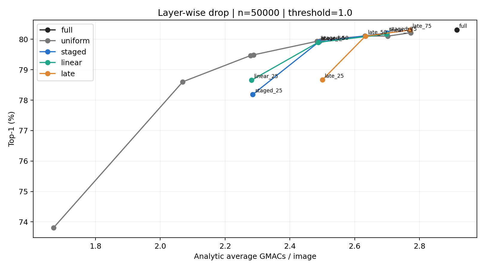
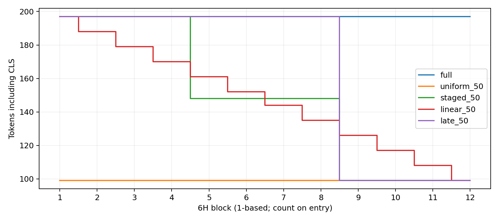

# Layer-wise Drop: Colab 측정 결과

실행 장치: Tesla T4. ImageNet-1K validation 50,000장, τ=1.0, 공식 EMA, 추가 학습 없음.
정밀도: float32, TF32 allowed. PyTorch 2.5.1+cu124.
평가 코드 commit: `8bd600696223b7863302b243467b754c4246274c`.
공식 ThinkingViT commit: `9254c4950d3159937ad682592d58a2be69708c42`.

## 무엇을 실험했나

ThinkingViT는 먼저 작은 3H 모델을 실행하고, 예측 entropy가 τ 이상인 어려운 이미지만 큰 6H 모델로 보낸다. 이번 실험은 routing과 가중치는 고정한 채 6H의 12개 Transformer Block에서 이미지 패치 토큰을 언제 제거할지 비교했다.

3H 마지막 Block의 head 평균 CLS attention으로 196개 패치의 중요도 순위를 한 번 정한다. 각 6H Block 진입 전에 그 순위의 Top-K만 남기며, 제거한 토큰은 복원하지 않고 CLS 토큰은 항상 유지한다. 학습이나 파인튜닝은 하지 않았다.

| 설정 | Block 1–4 | Block 5–8 | Block 9–12 | 의미 |
| --- | ---: | ---: | ---: | --- |
| `full` | 100% | 100% | 100% | 제거하지 않는 기준 |
| `uniform_r` | r | r | r | 처음부터 끝까지 같은 비율 |
| `staged_r` | 100% | (100%+r)/2 | r | 네 Block마다 계단식 감소 |
| `linear_r` | 100%에서 시작 | 선형 감소 | r에서 종료 | Block마다 조금씩 감소 |
| `late_r` | 100% | 100% | r | 마지막 네 Block에서만 제거 |

`r`은 25%, 50%, 75% 중 하나이며 원래 패치 196개에 대한 유지율이다. 예를 들어 50%는 패치 98개와 CLS를 합친 99토큰이다. `uniform_n148`은 모든 Block에서 패치 148개와 CLS를 유지한다.

같은 최종 유지율이라도 staged/linear/late는 앞 Block에서 더 많은 토큰을 계산한다. 따라서 각 가변 스케줄은 전체 6H MACs가 가장 가까운 `matched_uniform`과 비교해야 한다. `uniform_gain_pp`는 이 동일 연산량 대조군 대비 paired 정확도 차이다.

## 정확도와 연산량

| 설정 | 전체 Top-1 (%) | Routed Top-1 (%) | 평균 GMACs | 가까운 고정 대조군 | 차이 (%p) | MACs 차이 (%) |
| --- | ---: | ---: | ---: | --- | ---: | ---: |
| full | 80.304 | 62.731 | 2.915 | — | — | — |
| uniform_25 | 73.808 | 44.694 | 1.671 | — | — | — |
| staged_25 | 78.188 | 56.856 | 2.285 | uniform_n124 | -1.300 | -0.209 |
| linear_25 | 78.658 | 58.161 | 2.282 | uniform_n123 | -0.810 | 0.278 |
| late_25 | 78.666 | 58.183 | 2.500 | uniform_n149 | -1.316 | -0.107 |
| uniform_50 | 78.604 | 58.011 | 2.069 | — | — | — |
| staged_50 | 79.914 | 61.648 | 2.490 | uniform_n148 | -0.032 | -0.268 |
| linear_50 | 79.900 | 61.609 | 2.487 | uniform_n147 | -0.036 | 0.253 |
| late_50 | 80.104 | 62.176 | 2.633 | uniform_n164 | -0.004 | 0.091 |
| uniform_75 | 79.936 | 61.709 | 2.484 | — | — | — |
| staged_75 | 80.212 | 62.476 | 2.701 | uniform_n172 | 0.108 | -0.111 |
| linear_75 | 80.170 | 62.359 | 2.699 | uniform_n172 | 0.066 | -0.249 |
| late_75 | 80.306 | 62.737 | 2.772 | uniform_n180 | 0.092 | -0.078 |
| uniform_n124 | 79.488 | 60.465 | 2.288 | — | — | — |
| uniform_n123 | 79.468 | 60.410 | 2.279 | — | — | — |
| uniform_n149 | 79.982 | 61.837 | 2.502 | — | — | — |
| uniform_n148 | 79.946 | 61.737 | 2.493 | — | — | — |
| uniform_n147 | 79.936 | 61.709 | 2.484 | — | — | — |
| uniform_n164 | 80.108 | 62.187 | 2.632 | — | — | — |
| uniform_n172 | 80.104 | 62.176 | 2.702 | — | — | — |
| uniform_n180 | 80.214 | 62.481 | 2.773 | — | — | — |

사전에 정한 단계적 50% 설정의 가까운 고정 대조군 대비 paired 차이:
-0.032%p; 정규근사 95% 구간 [-0.159, 0.095]%p.
구간은 개별 고정 비교용이며 다중 비교나 최고 설정 선택 효과를 보정하지 않았다.

## 결론

- 25% 유지에서는 모든 가변 스케줄이 동일 연산량 uniform보다 유의하게 나빴다.
- 50% 유지에서는 staged/linear/late 모두 동일 연산량 uniform과 통계적으로 구분되지 않았다.
- staged_75는 동일 연산량 대조군보다 0.108%p 높았다 (95% 구간 [0.020, 0.196]%p).
- late_75는 동일 연산량 대조군보다 0.092%p 높았다 (95% 구간 [0.002, 0.182]%p).
- 따라서 레이어별 제거가 항상 유리하지는 않으며, 이번 조건에서는 완만한 75% 유지에서만 작은 이점이 관찰됐다.

## 실제 전체 추론 시간

| 설정 | 이미지 수 | 평균 (ms) | p50 (ms) | p95 (ms) | 실제 6H 진입 비율 |
| --- | ---: | ---: | ---: | ---: | ---: |
| full | 1000 | 26.155 | 22.391 | 54.231 | 0.332 |
| uniform_50 | 1000 | 22.990 | 18.825 | 49.897 | 0.332 |
| staged_50 | 1000 | 23.149 | 19.036 | 50.163 | 0.332 |
| uniform_n148 | 1000 | 22.846 | 19.045 | 49.978 | 0.332 |

MACs는 Block별 토큰 수로 계산한 해석적 추정이며 정렬/gather·norm·softmax·분기 비용은 제외한다.
실제 시간은 batch 1에서 3H·attention 수집(drop)·gate·필요한 6H·정렬/gather·동기화를 포함한다.
이미지 읽기·전처리·전송은 시간에서 제외한다. Colab GPU 측정치이며 모바일 실측이 아니다.
같은 validation에서 여러 스케줄을 비교했으므로 최고 점수를 독립 검증 성능으로 해석하지 않는다.

