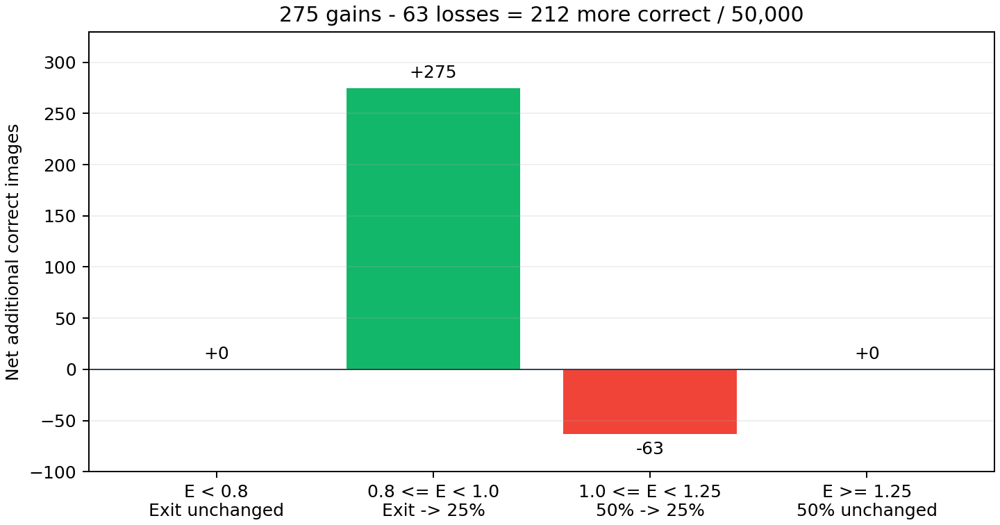
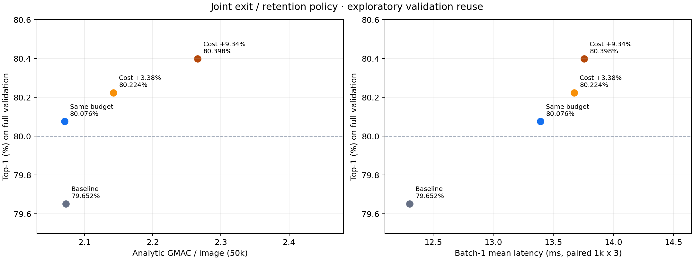

# 80% 목표 실험 결과 · 종료 게이트와 토큰 유지율 공동 조정

**기존 학생 가중치 그대로 실제 ImageNet-1K validation 50,000장에서 80.076%를 측정했다.** 기존 79.652% 대비 +0.424%p이며, 평균 분석 비용은 2.072270 → 2.070393 GMAC/장으로 0.091% 줄었다.

**실제 속도는 개선되지 않았다.** 같은 1,000장·batch 1·3회 측정에서 12.306 → 13.392ms로 8.82% 느려졌다. 정확도 80%와 평균 MAC 예산 목표를 충족한 관측 결과이며, 속도까지 개선한 결과는 아니다.

기존 validation을 보정과 반복 탐색에 사용했다. 전체 수치는 보정용을 포함하고, 과거 holdout도 이미 확인한 자료다. 아래 결과를 새로운 독립 평가나 미지의 모집단 정확도 80% 보장으로 해석하지 않는다.

## 1. 기존 실험과 달라진 부분

이전 선택기 실험은 3H 종료 기준을 entropy 1.0으로 고정했다. 이번에는 종료 기준과 토큰 유지율을 함께 조정했다. 공식 상위 10개 확률 재정규화 entropy를 그대로 사용하며, 가중치와 crop 0.9·bicubic 전처리는 바꾸지 않았다. 비선택 토큰을 제거하는 token drop 구현이다.

| entropy 구간 | 기존 방식 | 이번 주 정책 | 패치 수 |
|---|---|---|---:|
| 0.8 미만 | 3H 종료 | 3H 종료 | 6H 미실행 |
| 0.8 이상, 1.0 미만 | 3H 종료 | 6H·25% | 49 |
| 1.0 이상, 1.25 미만 | 6H·50% | 6H·25% | 49 |
| 1.25 이상 | 6H·50% | 6H·50% | 98 |

CLS는 항상 포함한다. 넓은 모델의 입력에는 기존 token recycling을 적용하고 이미지마다 선택된 6H 경로 하나만 실행한다. 전체 50,000장 중 27,400장은 종료, 9,350장은 25%, 13,250장은 50% 경로를 실행했다. 6H 진입률은 36.138%에서 45.200%로 증가했다.

## 2. 정책을 선택한 절차

사전 고정한 0.00~2.35의 0.05 간격 경계와 종료 끝점을 사용했다. 고정 유지율 25·50·75·90·100% 및 단조 exit→25→50→75% 경계 조합 21,070개를 기존 보정용 25,000장으로만 비교했다. 후보 수는 경로가 동등한 경계 조합도 포함한다.

주 정책은 기존 고정 50%의 정수 MAC 합계 이내에서 보정용 정답 수가 가장 많은 규칙이다. 별도로 보정용 80.0%, 80.2%를 만족하는 최소 비용 규칙도 각각 고르고 정책 파일을 저장했다. 그 다음 과거 holdout 집계와 실제 GPU 재평가를 수행했다. 평가 결과로 경계를 다시 바꾸지 않았다.

## 3. 전체 validation 실제 GPU 결과

| 정책 | 정답 수 / 50,000 | Top-1 (%) | GMAC/장 | 기존 대비 비용 |
|---|---:|---:|---:|---:|
| 기존 고정 50% | 39,826 | 79.652 | 2.072270 | +0.000% |
| 같은 비용 정책 | 40,038 | 80.076 | 2.070393 | -0.091% |
| 추가 비용 +3.38% | 40,112 | 80.224 | 2.142252 | +3.377% |
| 추가 비용 +9.34% | 40,199 | 80.398 | 2.265906 | +9.344% |

추가 비용 3.38% 정책: 종료 경계 0.75, 25→50% 경계 1.15. 추가 비용 9.34% 정책은 여기에 50→75% 경계 1.75를 사용한다. 이 두 결과는 같은 비용의 성과로 계산하지 않는다.

| 분할 | 기존 Top-1 (%) | 주 정책 Top-1 (%) | 차이 (%p) | 조건부 95% 구간 (%p) | 주 정책 GMAC/장 |
|---|---:|---:|---:|---|---:|
| 보정용 25,000장 | 79.504 | 79.872 | +0.368 | [+0.188, +0.544] | 2.072482 |
| 과거 holdout 25,000장 | 79.800 | 80.280 | +0.480 | [+0.292, +0.660] | 2.068305 |
| 전체 50,000장 | 79.652 | 80.076 | +0.424 | [+0.296, +0.552] | 2.070393 |

구간은 이미 선택한 예측을 고정한 paired bootstrap 5,000회·seed 0이다. 탐색과 선택 불확실성을 모두 반영한 확증 구간은 아니다. 주 정책은 보정용에서는 80%에 못 미쳤고 과거 holdout과 전체 validation에서 80%를 넘었다.

## 4. 어디에서 212장을 더 맞혔는가?

| entropy 구간 | 이미지 수 | 오답→정답 | 정답→오답 | 정답 순증 |
|---|---:|---:|---:|---:|
| entropy < 0.8 | 27,400 | 0 | 0 | +0 |
| 0.8 <= entropy < 1.0 | 4,531 | 467 | 192 | +275 |
| 1.0 <= entropy < 1.25 | 4,819 | 168 | 231 | -63 |
| entropy >= 1.25 | 13,250 | 1 | 1 | +0 |

새로 6H를 적용한 0.8~1.0 구간의 순증 275장이, 1.0~1.25 구간에서 토큰을 줄여 생긴 손실 63장보다 컸다. 1.25 이상 구간은 같은 경로지만 2장의 정오가 교차했다. 배치 그룹 구성에 따른 수치 변동으로 해석하며 순증은 0이다.

## 5. 사후 교차검증 안정성

전체 50,000장을 다시 5-fold로 나눠, 각 fold의 학습 40,000장으로만 정책을 선택하고 나머지 10,000장을 예측했다. 두 시드는 같은 자료를 재분할한 것이다. 100%와 98% 학습 예산 모두 주 정책을 바꾸지 않는 사후 진단으로 수행했다.

| 시드 | 학습 예산 | OOF Top-1 (%) | GMAC/장 | 평균 비용 변화 | 평가 fold 중 원래 비용 초과 |
|---|---:|---:|---:|---:|---:|
| 20261108 | 100% | 80.062 | 2.069599 | -0.129% | 3/5 |
| 20261108 | 98% | 79.924 | 2.026148 | -2.226% | 0/5 |
| 20261109 | 100% | 80.076 | 2.070785 | -0.072% | 2/5 |
| 20261109 | 98% | 79.956 | 2.028436 | -2.115% | 0/5 |

100% 예산의 10개 fold 모두에서 종료 경계 0.8이 선택됐다. 25→50% 경계는 9개에서 1.25, 1개에서 1.30이었다. 두 시드의 평균 비용은 기준보다 낮았지만 일부 fold는 초과했다. 98%로 여유를 둔 경우 모든 fold의 원래 비용 한도를 지켰으나 정확도는 80%보다 낮았다. 평균 비용 목표가 모든 새 표본의 비용을 보장하는 것은 아니다.

## 6. 실제 지연시간

RTX 3090에서 같은 과거 holdout 1,000장·batch 1·warmup 50·3회 회전 순서로 측정했다. 3H·게이트·Top-K·recycling·선택된 6H를 포함하고, 이미지 디코딩·전처리·입력 H2D는 제외한다.

| 정책 | 평균 ms | p50 ms | p95 ms | GPU peak allocated MiB |
|---|---:|---:|---:|---:|
| 기존 고정 50% | 12.306 | 8.754 | 19.049 | 97.27 |
| 같은 비용 정책 | 13.392 | 8.905 | 19.159 | 97.27 |
| 추가 비용 +3.38% | 13.673 | 8.966 | 19.161 | 97.27 |
| 추가 비용 +9.34% | 13.756 | 9.166 | 19.320 | 97.63 |

12회 실행 모두 batch 64 GPU 결과와 선택 경로·정답 여부가 일치했다. 분석 MAC이 같아도 6H에 진입하는 이미지가 늘면 시간은 늘 수 있다. 이번에는 실제로 지연시간이 증가했고, 커널별 원인을 분리해 입증한 것은 아니다. 모바일 지연시간은 측정하지 않았다.

## 7. 실행 검증과 추가 학습 상태

원래 학생 SHA-256과 전처리를 확인했다. 3H entropy의 기존 캐시 대비 최대 오차 0, 3H 정답 여부 불일치 0이다. 주 정책은 50,000장 전체에서 선택·정답 여부 모두 캐시와 일치했다. 기준 정책과 추가 비용 정책에는 각각 2장·1장·2장의 정답 여부 차이가 있어 그대로 기록했다. 주 정책의 80.076%는 실제 조건부 실행으로 확인한 값이다.

코드 검사 53개가 통과했다. 이미지 ID 50,000개, 예측과 정답 여부, split별 정수 MAC 합계, 시간 표본을 재검사했다. 가중치·코드 해시, 정책, 후보 탐색 결과, 이미지별 실제 예측·유지율, crossfit 분할과 정책, 지연 원자료를 보존했다.

50% 유지율 전용 KD와 CE+KD 추가 학습은 각각 10단계 실행 점검만 완료했다. 기존 가중치의 정책 조정으로 목표에 도달해 전체 1 epoch 학습으로 진행하지 않았다. 이 중간 가중치는 위 정확도·시간 측정에 사용하지 않았다.

## 8. 결론과 다음 방향

이번 관측에서는 새 gate 네트워크나 추가 파인튜닝 없이, 종료 기준과 유지율의 공동 조정으로 평균 MAC 예산을 유지하며 80%를 넘었다. 이전 고정 gate 1.0 실험의 실패와 모순되지 않는다. 당시에는 3H에서 종료된 이미지에 계산을 다시 배분할 수 없었다.

다음에는 이 단순 규칙을 새로운 비교 기준으로 고정하고, 50% 유지율 전용 파인튜닝 또는 CPU/GPU 실행 최적화가 정확도와 시간에 추가 이득을 주는지 분리해서 검증하는 것이 적절하다. 기존 validation 반복 탐색의 영향을 고려해 독립 평가 계획도 먼저 정해야 한다.

원시 결과: `/home/misys/OnDevice/.worktrees/adaptive-drop/results/20261108-target80`. 실행 안내: `baseline/target80_README.md`. 고정 설정: `configs/target80_20261108.json`. 서버 로컬 경로이며 공개 다운로드 링크는 아니다.
