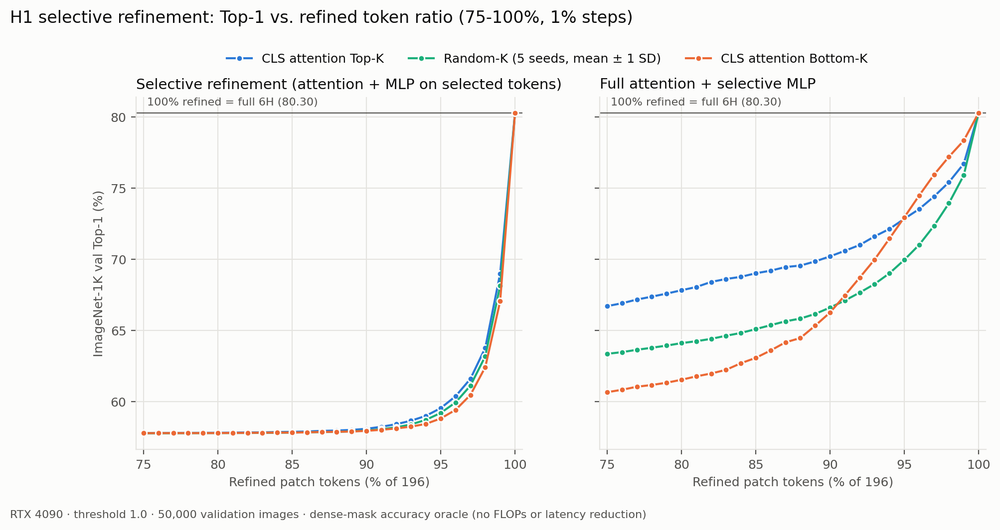
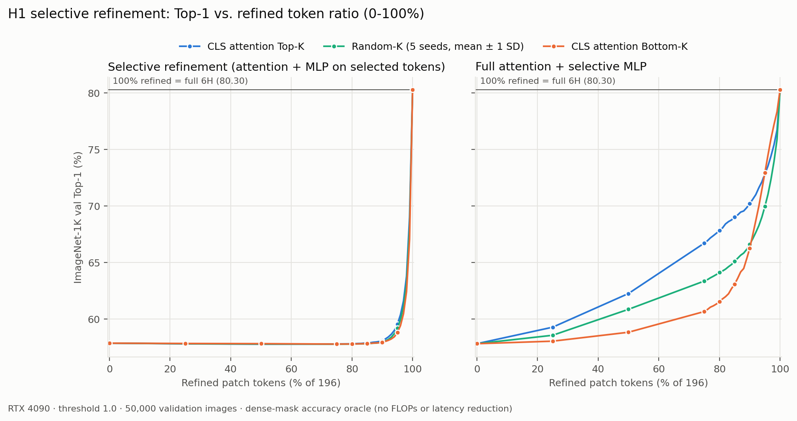

# RTX 4090 재현과 H1 고비율(76~100%) sweep

2026-11-01, 문화관 AIX408-20에서 실행했다. 목적은 두 가지다.

1. RTX 3090에서 측정한 early-exit baseline과 H1 두 실험이 다른 GPU에서도 같게 나오는지 확인한다.
2. H1의 75%와 100% 사이를 1% 간격으로 채워, 갱신 비율이 올라갈 때 정확도가 어디서 회복되는지 본다.

지연시간은 이번에 재지 않았다. 같은 시간에 ImageNet train을 내려받고 있어 CPU 경합이 있었기 때문이다. 다운로드가 끝나면 따로 측정한다.

## 환경

| 항목 | 값 |
| --- | --- |
| GPU | NVIDIA GeForce RTX 4090 24GB, driver 535.183.01 |
| OS / Python | Ubuntu 22.04.5, Python 3.10.12 |
| PyTorch / CUDA | 2.5.1+cu124 / 12.4 |
| 정밀도 | float32, AMP off, TF32 허용 (공식 기본값) |
| 공식 코드 | ThinkingViT `9254c4950d3159937ad682592d58a2be69708c42`, 변경 없음 |
| 가중치 | `thinkingvit_3h6h_ema.pth`, SHA256 `9ead984e…7242b5` (10/14 3090 측정과 동일) |
| 데이터 | ImageNet-1K validation 50,000장 |

baseline은 `main`(`ac7ff72`), H1은 각 브랜치(`dcc13c6`, `f30d821`)를 체크아웃해 실행했다. 실행별 환경은 [`reports/2026-11-01/provenance.json`](reports/2026-11-01/provenance.json)에 있다.

## 1. Early-exit baseline

```bash
CUDA_VISIBLE_DEVICES=0 .venv/bin/python baseline/evaluate.py \
  --mode accuracy --batch-size 128 --verify-samples 128 --compare-official
```

| Threshold | Top-1 (4090) | Top-5 (4090) | 6H 비율 | Top-1 (3090, 10/14) |
| ---: | ---: | ---: | ---: | ---: |
| 10.0 | 73.534% | 92.048% | 0% | 73.534% |
| 0.0 | 81.440% | 95.720% | 100% | 81.440% |
| 1.0 | 80.304% | 95.278% | 36.008% | 80.304% |

세 threshold 모두 Top-1·Top-5·6H 비율이 3090 결과와 소수점까지 같다. 공식 경로와의 logits 최대 오차는 0, Top-1과 단계 선택도 모두 일치했다.

## 2. H1 재현 (0 / 25 / 50 / 75 / 100%)

각 브랜치 문서의 명령을 그대로 실행했다.

```bash
CUDA_VISIBLE_DEVICES=0 .venv/bin/python baseline/evaluate_selective.py \
  --ratios 0 .25 .5 .75 1 --policies topk bottomk random --random-seeds 0 1 2 3 4 --batch-size 32
# experiment/h1-attention-full-mlp-selective 에서는 evaluate_mlp_selective.py, 인자 동일
```

전체 Top-1, 괄호 안은 원래 3090 결과다. Random은 5개 seed 평균 ± 표준편차다.

**선택적 갱신** (`experiment/h1-selective-token-refinement`)

| 갱신 비율 | Top-K | Bottom-K | Random |
| ---: | ---: | ---: | ---: |
| 0% (CLS만) | 57.862 (57.858) | | |
| 25% | 57.804 (57.800) | 57.834 (57.830) | 57.811 ± 0.005 (57.810) |
| 50% | 57.772 (57.768) | 57.818 (57.814) | 57.784 ± 0.006 (57.779) |
| 75% | 57.788 (57.784) | 57.782 (57.778) | 57.772 ± 0.005 (57.770) |
| 100% | 80.304 (80.312) | | |

**Attention 전체 + MLP 선택** (`experiment/h1-attention-full-mlp-selective`)

| 갱신 비율 | Top-K | Bottom-K | Random |
| ---: | ---: | ---: | ---: |
| 0% (CLS만) | 57.814 (57.812) | | |
| 25% | 59.276 (59.264) | 58.038 (58.036) | 58.560 ± 0.027 (58.578) |
| 50% | 62.256 (62.248) | 58.828 (58.820) | 60.858 ± 0.050 (60.853) |
| 75% | 66.714 (66.716) | 60.662 (60.674) | 63.361 ± 0.015 (63.336) |
| 100% | 80.304 (80.312) | | |

차이는 최대 0.025%p(약 13장)로, 3090과 4090의 부동소수점 차이로 경계 예측 몇 장이 바뀌는 수준이다. 두 브랜치의 결론(선택적 갱신 붕괴, MLP 선택에서 Top-K > Random > Bottom-K)은 그대로다.

## 3. 고비율 sweep (75~100%, 1% 간격)

같은 평가기에 비율만 바꿨다. 1%는 패치 196개 중 약 2개다(선택 개수는 `round(196 × ratio)`).

```bash
CUDA_VISIBLE_DEVICES=0 .venv/bin/python baseline/evaluate_selective.py \
  --ratios $(seq 0.76 0.01 1.00) --policies topk bottomk random --random-seeds 0 1 2 3 4 --batch-size 32
# MLP 선택 브랜치도 evaluate_mlp_selective.py로 동일하게 실행
```





주요 비율의 전체 Top-1이다. 1% 간격 전체 값은 [`h1_ratio_sweep.csv`](reports/2026-11-01/h1_ratio_sweep.csv)에 있다.

| 갱신 비율 | 선택적 갱신 Top-K | Random | Bottom-K | MLP 선택 Top-K | Random | Bottom-K |
| ---: | ---: | ---: | ---: | ---: | ---: | ---: |
| 75% | 57.788 | 57.772 | 57.782 | 66.714 | 63.361 | 60.662 |
| 80% | 57.808 | 57.787 | 57.790 | 67.830 | 64.112 | 61.536 |
| 85% | 57.872 | 57.824 | 57.820 | 69.024 | 65.098 | 63.076 |
| 90% | 58.088 | 57.965 | 57.944 | 70.212 | 66.613 | 66.264 |
| 92% | 58.410 | 58.191 | 58.112 | 71.014 | 67.666 | 68.722 |
| 94% | 58.998 | 58.715 | 58.432 | 72.142 | 69.024 | 71.464 |
| 95% | 59.542 | 59.203 | 58.814 | 72.856 | 69.967 | 72.962 |
| 96% | 60.376 | 59.938 | 59.416 | 73.540 | 71.026 | 74.492 |
| 97% | 61.602 | 61.121 | 60.468 | 74.422 | 72.364 | 75.958 |
| 98% | 63.784 | 63.189 | 62.424 | 75.426 | 73.949 | 77.216 |
| 99% | 69.006 | 68.144 | 67.058 | 76.728 | 75.910 | 78.356 |
| 100% | 80.304 | | | 80.304 | | |

### 관찰

1. **선택적 갱신은 90%까지 거의 움직이지 않는다.** 75%에서 90%까지 Top-K가 57.79% → 58.09%로 0.3%p 오를 뿐이다. 99%(194/196개 갱신)에서도 69.01%로, 100%보다 11.3%p 낮다. 갱신하지 않은 토큰이 2개만 있어도 크게 떨어진다. 비율보다 "고정된 토큰이 하나라도 있는가"가 결정적이라는 뜻으로, 고정 토큰이 0층 상태로 남아 다른 토큰의 attention을 오염시킨다는 10/27 진단과 맞는다.
2. **MLP 선택은 75~90%에서 Top-K가 계속 앞선다.** Top-K는 Random보다 3.4~3.9%p, Bottom-K보다 3.9~6.3%p 높다.
3. **90%를 넘으면 순서가 뒤집힌다.** Bottom-K가 약 91%에서 Random을, 약 95%에서 Top-K를 넘어선다. 99%에서는 Bottom-K 78.36% > Top-K 76.73% > Random 75.91%다. 고비율의 Bottom-K는 CLS attention이 가장 높은 소수 토큰을, Top-K는 가장 낮은 토큰을 갱신에서 뺀다. 즉 몇 개만 뺄 때는 attention이 높은 토큰을 빼는 쪽이 덜 손해다. 이 토큰들이 attention이 몰리는 sink·high-norm 토큰일 가능성이 있지만 아직 확인하지 않은 추정이다. 토큰 norm과 위치를 보면 검증할 수 있다.
4. **어느 쪽이든 100% 미만이면 정확도를 잃는다.** MLP 선택에서 가장 좋은 99% Bottom-K도 100%보다 1.9%p 낮다. 이 평가기는 dense mask로 정확도만 보는 oracle이라 FLOPs·지연시간 절감은 측정하지 않는다.

## 실행 시간과 그래프 재생성

4090 기준 baseline 정확도(threshold 3개)는 약 4분, H1 기본 비율은 브랜치마다 약 3.5분, 1% sweep은 브랜치마다 약 25분이 걸렸다.

```bash
.venv/bin/python -m pip install -r requirements-analysis.txt
.venv/bin/python baseline/plot_h1_ratio_sweep.py \
  --selective results/<기본 비율 실행> results/<76~100% 실행> \
  --mlp results/<기본 비율 실행> results/<76~100% 실행> \
  --output baseline/reports/2026-11-01
```

같은 (비율, 정책, seed)가 여러 실행에 있으면 뒤에 준 실행의 값을 쓴다. 비율 0과 100%는 정책과 무관하게 같은 경로라서 모든 선의 양 끝점으로 그린다.

## 파일 (`reports/2026-11-01/`)

- `accuracy.json`, `accuracy_verification.json`: baseline 정확도와 공식 경로 검증
- `h1_selective_refinement.json`, `h1_selective_refinement_76_100.json`: 선택적 갱신 결과 (기본 비율 / 76~100%)
- `h1_mlp_selective_refinement.json`, `h1_mlp_selective_refinement_76_100.json`: MLP 선택 결과
- `h1_ratio_sweep.csv`: 그래프에 쓴 방법·비율·정책별 평균과 표준편차
- `h1_ratio_sweep_full.png`, `h1_ratio_sweep_76_100.png`: 그래프
- `provenance.json`: 실행별 환경, 코드 커밋, 가중치 해시
